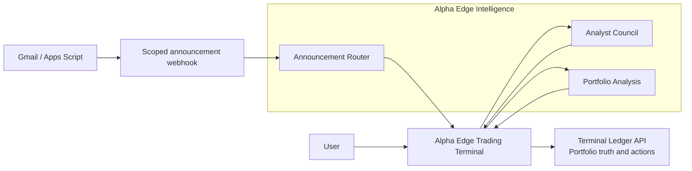

# Alpha Edge Intelligence Architecture And Migration Plan

Status: active v1.0 migration contract. Phases 1 and 2 are implemented in this
working branch and await deliberate deployment.

This document defines how this repository becomes the **Alpha Edge Intelligence
Service**. It is an implementation companion to the canonical product model in
the Alpha Edge Trading Terminal repository at `DOCS/PRODUCT_ARCHITECTURE.md`.

It is deliberately a migration plan, not a request to split this codebase into
separate microservices or introduce a new authentication product.

## Purpose

Alpha Edge is one investment operating system with two operational domains:

1. **Alpha Edge Trading Terminal** is the primary user surface and portfolio
   ledger. It owns holdings, statements, actions, approvals, and the user
   workflow.
2. **Alpha Edge Intelligence** is the separate analysis runtime in this
   repository. It produces research and other evidence for the Terminal.

Alpha Edge Intelligence contains three capabilities:

| Capability | Purpose | It must not do |
| --- | --- | --- |
| **Analyst Council** | Per-security research, model outputs, report packets, and run artefacts. | Alter holdings, approve a trade, or own portfolio truth. |
| **Announcement Router** | Evaluate a new announcement against prior research and produce auditable scenario or conviction evidence. | Silently change a security, portfolio allocation, or user action. |
| **Portfolio Analysis** | Produce a top-down portfolio analysis and durable Portfolio Memo. | Approve the portfolio shape or execute a portfolio action. |

The durable source of portfolio truth remains the Trading Terminal ledger. An
Intelligence result is evidence, not an autonomous action.

## Migration Baseline

The current deployment is the Fly application `llm-council-analysis`. It is a
single FastAPI application that also serves a built React application. It has a
mounted data volume for persisted jobs and outputs.

This is a reasonable physical deployment boundary for now. The problem is not
that multiple capabilities share one origin; it is that the origin currently
mixes browser pages, API routes, service status, and development tooling without
a deliberate public contract.

The following conditions existed before the Phase 1 and 2 working-branch
implementation. They remain useful as the migration baseline:

1. `GET /` returns a JSON service-status payload. That is acceptable for a pure
   API but not as the front door of a service that also presents human-facing
   Council, Router, and Portfolio Analysis screens.
2. `/api/health` is listed as an open route in middleware but has no concrete
   FastAPI handler. The SPA fallback can therefore return HTML rather than a
   health response.
3. The Fly configuration has no HTTP health check.
4. FastAPI's default `/docs`, `/redoc`, and `/openapi.json` surfaces are public
   unless deliberately disabled or protected.
5. The browser frontend still identifies itself as `frontend` and uses the
   Vite favicon.
6. The direct browser frontend prompts for the broad Council API token and
   stores it in browser local storage. The Trading Terminal already has a
   safer server-side proxy for many Council requests, but several Terminal
   links still point directly to the Fly hostname.

## Target Service Shape

The technical Fly app may continue to be called `llm-council-analysis` during
the migration. That name is an implementation identifier, not user-facing
language. Do not rename the Fly application until callers, webhooks, and
deployment operations have been migrated deliberately.

The three capabilities remain one deployable service until there is a concrete
reason to split them: materially different scaling, a separate operator team,
or an independent security boundary. None of those conditions currently exist.

## Route Contract

The service should separate human UI, machine API, operational endpoints, and
external ingress. The following are canonical *future* paths; legacy paths stay
available during migration.

| Surface | Canonical path | Access | Notes |
| --- | --- | --- | --- |
| Intelligence home | `/` | Human | Compact operational launcher, not a marketing page. |
| Analyst Council | `/council` | Human | Per-security research and run exploration. |
| Research runs | `/council/runs` | Human | Durable research-run and evidence exploration. |
| Announcement Router | `/announcement-router` | Human | Auditable announcement evidence and review. |
| Portfolio Analysis | `/portfolio-analysis` | Human | Portfolio Analysis and Portfolio Memo review. |
| Liveness | `/healthz` | Public | Minimal process response only. |
| Readiness | `/readyz` | Public | Confirms required storage/configuration is usable. |
| Protected service status | `/api/v1/status` | Terminal/operator | May expose maintenance and queue state. |
| Machine API | `/api/v1/...` | Terminal/operator | Versioned service contract. |
| Inbound webhook | `/webhooks/announcement-router` | Scoped external ingress | Signature/secret checked at route level. |

### Health Semantics

`/healthz` answers only whether the process is alive. It must not reveal
`system_enabled`, shutdown rationale, keys, provider configuration, or job data.

`/readyz` answers whether the service can accept ordinary requests: the data
volume is writable, persisted job state can load, and essential configuration is
present. Intentional maintenance mode is a business state, not a process-health
failure; expose that only through the protected status route.

Configure Fly's HTTP service check against `/readyz`. This makes deployment
readiness observable and prevents traffic being sent to an application that has
started but cannot serve its workload.

### API And SPA Rules

1. An unknown `/api/...` path must return a JSON `404`, never the React
   `index.html` document.
2. The SPA fallback should serve only known human routes and client-side routes.
3. New stable service endpoints should be introduced under `/api/v1`; existing
   `/api/...` endpoints are retained as compatibility aliases until the
   Terminal and external clients move.
4. Production API documentation is disabled by default or protected behind an
   explicit operator mode. UAT and local development may expose it deliberately.
5. Redirect legacy UI paths only after their replacement is live. Initial
   mapping:

| Existing path | Canonical successor | Migration behaviour |
| --- | --- | --- |
| `/gantt-lab` | `/council/runs` | Keep and redirect after Terminal links migrate. |
| `/portfolio-positioning` | `/portfolio-analysis` | Keep query parameters such as `run_id`. |
| `/scenario-router` | `/announcement-router` | Preserve as an alias while external references exist. |
| `/api/announcement-router/...` | `/api/v1/announcement-router/...` | Publish compatible v1 contract before redirecting. |

## Access And Credential Policy

The system should use a small number of stable, scoped credentials. It should
not require an API key per page, action, or route.

| Flow | Credential | Where it lives | Rule |
| --- | --- | --- | --- |
| Trading Terminal server to Intelligence | One service token | Fly secrets in both server applications | Server-to-server only; never delivered to browser JavaScript. |
| Gmail / Apps Script to Announcement Router | One webhook secret | Apps Script properties and Intelligence secret | Limited to the ingress handler; idempotency remains based on message/event identity. |
| Human browser access | Alpha Edge session or short-lived handoff | HttpOnly session mechanism when introduced | Never persist the broad service token in local storage or URL parameters. |
| Health checks | None | N/A | Return minimal non-sensitive response. |

The current signed Announcement Router ingress is the correct pattern: a
narrowly scoped credential checked by the receiving route. Keep it. The change
is to remove the broad Council API token from normal browser use, not to add
more credentials.

### Terminal-To-Intelligence Transport

The Trading Terminal should keep calling Intelligence from its server-side
proxy, where the service token already belongs. A later migration may use Fly
private networking through `llm-council-analysis.internal` or Flycast, but only
after a connectivity preflight. The current Uvicorn process binds to IPv4;
private IPv6 connectivity and service binding must be tested before changing the
base URL.

Do not put a long-lived bearer token into a new tab URL, query parameter, or
browser local storage as a shortcut. A shared Alpha Edge session or short-lived,
single-use handoff is the eventual browser-access solution.

## Visual Identity And Browser Shell

The browser application should be recognisable as part of Alpha Edge without
pretending to be the Trading Terminal.

### Naming

| Location | Required copy |
| --- | --- |
| Browser home title | `Alpha Edge Intelligence` |
| Council title | `Analyst Council | Alpha Edge` |
| Router title | `Announcement Router | Alpha Edge` |
| Portfolio title | `Portfolio Analysis | Alpha Edge` |
| Header product lockup | `ALPHA EDGE / INTELLIGENCE` |

`LLM Council` remains a legacy implementation name. It should not be the
top-level product identity or browser title.

### Icon System

Create a dedicated Intelligence mark rather than copying the Trading Terminal
icon or keeping Vite branding:

1. The favicon is the compact, legible 16px/32px version of the Intelligence
   mark.
2. The header uses the same mark beside the Alpha Edge wordmark and
   `INTELLIGENCE` label.
3. The mark uses the same restrained typography and palette family as the
   Trading Terminal, but a different shape so the user can distinguish the
   analysis runtime at a glance.
4. Each capability uses a plain contextual title: Analyst Council, Announcement
   Router, or Portfolio Analysis. Avoid generic labels such as `frontend` or
   generic launch buttons such as `Open Timeline Lab`.

The home page should be a compact launch/status surface for the three
capabilities. It is not a landing page and it must not become a second portfolio
dashboard.

## Migration Plan

### Phase 0: Contract And Inventory

- Adopt this document as the service-boundary contract.
- Inventory every caller of the current Fly hostname, every API path, and every
  external webhook.
- Centralise the Terminal's direct Council browser URLs behind one helper and
  environment setting. Do not change user-visible routing yet.
- Define a compatibility table for legacy paths and query parameters.

**Exit criteria:** every external caller has an owner and a migration path.

### Phase 1: Operational Correctness

- Add concrete `/healthz` and `/readyz` routes.
- Add an HTTP readiness check to `fly.toml`.
- Make unknown API paths return JSON `404` responses.
- Make FastAPI docs/schema explicitly enabled only for local/UAT/operator mode.
- Move detailed service-control state from the root response to a protected
  status route.

**Exit criteria:** health, readiness, authentication, documentation, and SPA
fallback behaviour are covered by automated route tests.

### Phase 2: Alpha Edge Intelligence Shell

- Replace Vite favicon, document title, and generic root screen.
- Add the Intelligence favicon and header lockup.
- Implement the canonical UI paths without removing legacy aliases.
- Rename visible navigation to Analyst Council, Announcement Router, and
  Portfolio Analysis.

**Exit criteria:** direct browser access looks and reads like Alpha Edge, and
all three capabilities remain reachable through old links.

### Phase 3: Terminal Integration

- Replace hard-coded Council URLs in the Trading Terminal with one configured
  Intelligence application URL.
- Keep API requests routed through the Terminal's server-side Council proxy.
- Replace normal browser token prompts with an Alpha Edge session/handoff
  design. Preserve direct token access only as a restricted operator fallback
  while that work is underway.

**Exit criteria:** ordinary Terminal users never see or store the broad Council
API token.

### Phase 4: Network And URL Migration

- Test private Fly connectivity from the Terminal API to Intelligence.
- Move server-to-server traffic to the private path only after bind, timeout,
  retry, and rollback tests pass.
- Add a custom public Intelligence hostname when an Alpha Edge domain and shared
  session model are ready.
- Retire legacy public paths only after monitoring shows no active callers.

**Exit criteria:** public browser traffic, private service traffic, and external
webhook traffic have distinct and documented boundaries.

## Verification Matrix

Before each phase is deployed, verify the following:

| Area | Required test |
| --- | --- |
| Health | `/healthz` is minimal JSON; `/readyz` fails correctly when required storage/configuration is unavailable. |
| API fallback | Unknown API path yields JSON `404`, not the React document. |
| Auth | Terminal proxy succeeds with service token; browser does not receive it; ingress rejects invalid webhook secret. |
| Compatibility | Existing Terminal Council links and legacy query parameters still open the intended view. |
| UI | Desktop and small viewport screenshots show Alpha Edge title, correct favicon, readable header, and no Vite/generic labels. |
| Deployment | Fly readiness check becomes healthy after deployment; rollback returns the previous image and keeps persisted data intact. |
| Authority | Council, Router, and Portfolio Analysis results cannot mutate holdings, actions, statements, or portfolio approvals without the Terminal workflow. |

## Non-Goals

This migration does not:

1. Split Analyst Council, Announcement Router, and Portfolio Analysis into
   independent Fly applications.
2. Rename the existing Fly application immediately.
3. Introduce automatic trading or give Intelligence ownership of portfolio
   truth.
4. Rotate secrets merely because this document exists.
5. Replace the Trading Terminal with the Intelligence browser shell.

## Decisions Still Needed

1. Which custom Alpha Edge domain, if any, should be used for the public
   Intelligence UI?
2. Should normal browser access be a shared first-party Alpha Edge session or a
   short-lived handoff from the Terminal while the product remains single-user?
3. Which existing generic Council chat capabilities are still active product
   features and should be preserved under `/council`, versus retained only as
   local/operator tools?
4. When private Fly transport is tested, should the service use direct 6PN
   `.internal` routing or Flycast for proxy-managed private routing?

Until these decisions are made, Phase 1 can proceed safely without changing
external URLs or the current deployment topology.
