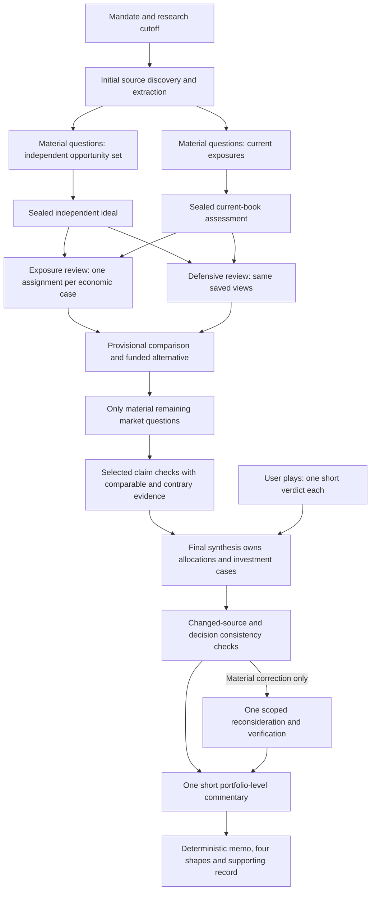
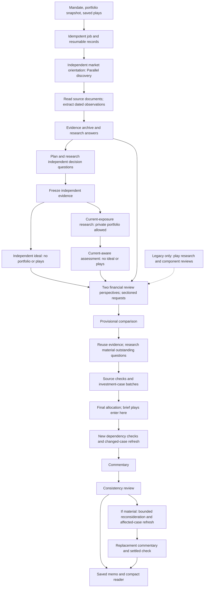
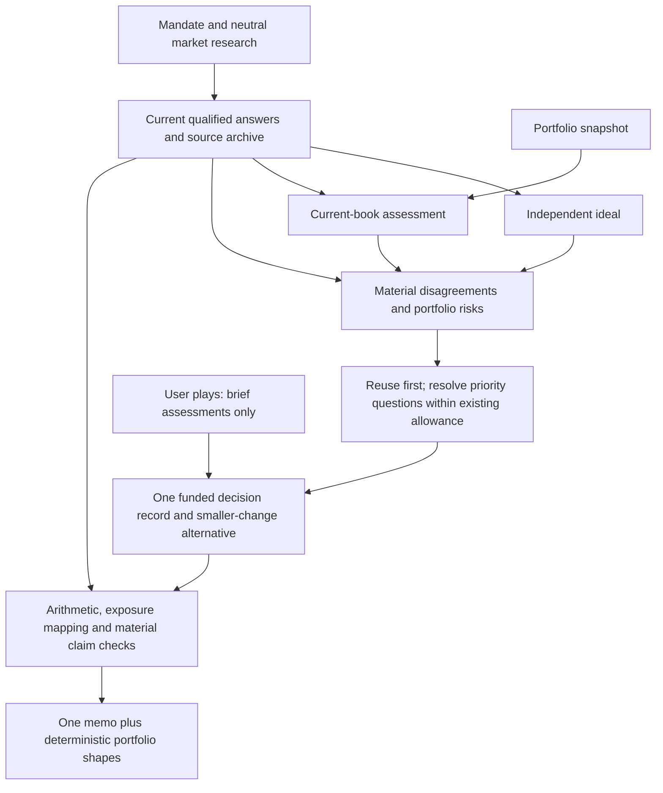

# Portfolio Memo: Architecture, Value Audit And Repair Direction

September 23, 2026. **Audit complete; L1-L6 deployed in Fly release 363.**
No paid requests, model changes or edits to historical memos. The implementation
record below supersedes the repair-status language in the original audit sections.

## Implemented Surgical Pass

### Deployment Verification

Deployed commit `f9d7697` to `llm-council-analysis` on September 23 at 13:42 UTC
(September 23 at 23:42 Melbourne). Release 363 uses image digest
`sha256:b9a5dcd6b592be2b65716adac5cca4184b88621c0e6b559497b8d1057640d6f1`.
Health checks and public `/readyz` pass; 173 deployed source/dependency/asset
checksums match this checkout. The live September 23 completed memo loads with
all four balanced portfolio shapes at desktop/mobile sizes in light/dark mode,
without browser errors or supporting-archive requests. Model-routing checksum
and all 44 pre-existing artifact-directory file names, sizes and modification
times are unchanged. Only the new v5 reader index was added. No analysis was
active before or after deployment, and no new paid analysis was started.
The full-run cost, timing and investment-quality acceptance below remains open.

### Reader Follow-Up: Deployed In Release 364

The legacy comparison exposed a remaining presentation omission: independent
memos hid Current Sleeve Decisions and Asset Class Targets. These sections are
now restored, alongside Allocation Rationale and the four recorded
portfolio shapes. Current decisions come from the final `current_sleeve_actions`
and snapshot weights, not the earlier sealed current-aware baseline. An absent
final assessment stays under review; no historical decision is invented. Reader
cache version 7 refreshes this derived view without changing the source artifact.

The recovered synopsis was 341 words with allocation lists and sector analysis.
Existing synthesis prompts now request a roughly 100-150-word investment abstract:
market judgment, decisive evidence, portfolio implication and principal risk.
This is editorial guidance, not an output-token cap, validation failure or extra
model call. Saved synopses are shown once, in full, with Markdown formatting.
Cash metrics show labels and percentages only. The full-width investment rationale
uses scoped styles and a labelled alternative scenario; no grey debug-panel leak.
Duplicated allocation tables are omitted from the body, retaining adjacent
legacy rationale, source citations and qualifications. Twelve focused backend
tests, frontend build/lint and six light/dark viewport checks passed. Preview:
`http://127.0.0.1:5397/portfolio-analysis?run_id=local-preview.json`.

The September 24 follow-up removes the blanket research-condition warning and
coverage-derived `action_readiness` label. Research gaps remain available but do
not mechanically veto an otherwise justified action. Current saved answers now
refresh gap status in qualifications, decision checks and supporting research;
partial/conflicting scopes and unsupported observations remain qualified.
Existing synthesis instructions require a decision-specific implication for
material uncertainty, distinguish forecasts from missing observable facts, and
update stale rationale even when weights do not change. No extra stage, model,
research budget or mandatory prose field is added. Older generated v4 memos
with that warning get a derived reader refresh; original artifacts are untouched.
The saved September 23 preview retains the allocation rationale and moves its
question lists into collapsed supporting research. New model compliance still
requires a future authorised run; this is not a claim that old conclusions were
rewritten or that investment quality has been revalidated.
Verification: 235 focused/regression tests and correctness lint passed; the saved
memo's collapsed research and retained rationale were checked in the browser.
The larger mocked full-workflow run hit local ENOSPC. Its temporary files were
removed; the remaining regressions passed with those 16 workflow variants excluded.
Full-workflow acceptance is therefore not claimed. No paid run was started.

Deployed September 23 at 14:43 UTC (September 24 at 00:43 Melbourne) as Fly
release 364, image digest
`sha256:d99177c4b1e55c8cff30e6f61e0e0abdb5434347dfdeb4249ab8eed5028dc768`.
All 173 deployed source/dependency/asset checksums match the local build. Health
checks and `/readyz` pass. The live September 23 completed memo was verified:
formatted synopsis, compact cash metrics, full-width rationale, four shapes,
no blanket research warning or raw question lists in the main allocation text,
and the questions retained in collapsed Supporting research. No horizontal
overflow was found. Model-routing checksum and every pre-existing artifact file's
name, size and modification time are unchanged; only the v7 reader index was added
at startup. No analysis was active before or after deployment.

### Architecture Choice

Keep the explicit, checkpointed parallel workflow. A single unconstrained agent
would lose the independent/current-book separation; an autonomous agent team
would add another opportunity for repeated research. A graph-framework migration
could improve infrastructure portability, but would not repair the lost answer
link, inflated evidence selection or repeated financial decisions. The current
async functions and persistence already express the dependencies we need.

This is consistent with the preference for simple composable workflows in
[Anthropic's engineering guidance](https://www.anthropic.com/engineering/building-effective-agents)
and the explicit node/state design described in
[LangGraph's workflow guidance](https://docs.langchain.com/oss/javascript/langgraph/thinking-in-langgraph).
Neither source proves financial quality for this application; saved-run evidence
and the actual dependency graph are the reasons for retaining this structure.



Research calls within each admitted wave remain concurrent. The two allocators
and the two reviewer roles retain their existing concurrency. Expansions wait
for the initial research wave, then consume the remaining allowance in investment
priority order and run concurrently. This deliberate barrier prevents the first
low-priority search to finish from buying the last deep-research slot.

### What Changed

| Repair | Construction and financial guardrail |
| --- | --- |
| Answer continuity | Follow explicit `reuse_question_id` relationships in both directions. Keep each answer once, with its own period, scope and qualifications. Planning, selection and final dependency qualification see the same current links. A related partial answer does not establish missing original dimensions. |
| Evidence selection | Select decision citations, linked answers, exact-scope comparable observations and explicit corrections before building the request view. Discovery tags do not automatically become decision dependencies. Preserve source support, adverse findings and explicit contrary citations. |
| Research priority | Prefer concrete decision consequences, critical premises and investment impact. Preserve the planner's order within ties instead of enforcing an asset-diversity quota. Existing budget and expansion policy remain; no new paid layer or estimated-credit blockade. |
| Review scope | No separate review task for every historical research question or duplicated research-assessment row. Each economic case gets its actual evidence and related discovery entries. Portfolio-wide review gets the whole discovery index once. Unseen material observations can still receive the existing single archived-source lookup. |
| Decision ownership | Final synthesis writes the actual investment cases. Removed automatic pre-final case batches and post-final case refresh from the normal path. The sole commentary call occurs after any scoped reconsideration. A changed case is retained with a review qualification, not silently erased or sent to another mandatory writer. |
| Exposure mapping | Exact identifiers and explicit equivalent baseline links can map scenario direction onto the baseline's own weight. Partial overlaps, substitutes and conflicting directions remain unknown. No fuzzy name matching, capital duplication, invented sensitivities or automatic return estimates. |
| Copying | Select the small fact/source subset before projection; do not build a full-archive prompt that will immediately be replaced. Signed-evidence repair uses copy-on-write in request construction. Existing archive and checkpoint mechanisms remain. |
| Presentation | Render current, independent ideal, recommended and smaller-change shapes from recorded weights. Invalid or incomplete shapes are labelled rather than normalized. Keep Markdown lists/paragraphs, remove the exact repeated executive text, use one portfolio-level explanation, retain existing light/dark themes and place supporting detail after the memo. |

The normal brief-play route still introduces ideas only at final synthesis, with
score, verdict, reason and action. It launches no play-only research or review.
Legacy component helpers and saved case recovery remain readable for old artifacts;
they are not extra mandatory stages in the new brief-play run.

### Saved-Artifact Acceptance

Reproduce without API calls:

```sh
.venv/bin/python -m scripts.audit_portfolio_stage_value --replay --output outputs/audits/portfolio-lean-build-20260923
```

The replay hashes all four historical artifacts and verifies they are unchanged.
Before/after use the same September 23 final archive, not different paid runs.

| Metric | Before this pass | After |
| --- | ---: | ---: |
| Later uranium answer citations reaching original-question selection | 0 | All 23 |
| Facts in settlement evidence | 1,696 | 470 |
| Settlement evidence JSON | 2,140,358 bytes | 779,665 bytes, down 63.6% |
| Entire final-synthesis prompt | 2,473,137 bytes | 1,114,813 bytes, down 54.9% |
| Python allocation peak constructing that prompt | 20,127,954 bytes | 3,278,626 bytes, down 83.7% |
| Construction time in this local probe | 8.455 seconds | 1.357 seconds; host load affects timing |
| Brief-play review packets, one reviewer | 21 | 9 |
| Brief-play review prompt JSON, one reviewer | 8,533,156 bytes | 3,193,243 bytes, down 62.6% |
| Standalone historical-question/research-assessment review units | 47 | 0 |
| Archived observations removed | 0 | 0; all 1,776 retained |

The seven removed historical case-writing calls cost $13.72 in reported model
usage in that saved lineage. That is evidence for removing repeated work, **not**
a forecast of savings on a future run. Final synthesis now owns their useful
content and may write more than the former delta-only response.

Scenario mapping is intentionally not claimed as fully solved for the old memo:
its unclassified ideal weight falls from 90% to 80%, not zero. The remaining
relationships are not recorded as equivalent. The new prompts request all four
views explicitly; inventing directions for the old artifact would hide missing
analysis rather than repair it.

### Verification And Remaining Limits

Focused tests cover linked answers across different periods, adverse/comparable
evidence, unchanged archives, investment-priority expansion despite out-of-order
completion, scenario equivalence without capital transfer, and recorded chart
weights. The mocked end-to-end workflow checks independent/current concurrency,
brief-play isolation, no case-writer calls, a single final commentary call,
retained case output and zero provider calls when completed checkpoints resume.
The reader is checked at 1440, 768 and 390 pixels in light and dark modes using
the actual September memo, with no paid requests or supporting-archive fetches.

Verification: 780 other unit cases and 43 independent-workflow cases passed in
separate invocations. The final focused workflow rerun also passed. Correctness
lint, frontend lint, build and the six-view reader check passed. Existing library
deprecation and frontend bundle-size warnings remain. Read-only presentation
preview: `http://127.0.0.1:5397/portfolio-analysis?run_id=local-preview.json`.

Still unproven: full Fly worker RSS, actual new-run elapsed time and provider
cost, and whether the final model uses the repaired evidence to make better
investment decisions. The old memo's prose was not rewritten to pretend those
outcomes have improved. A separately authorized run can measure them; another
research layer, framework migration or arbitrary output cap is not the remedy.

## Decision

Keep the research capability. Simplify the work between research and a usable decision.
The strongest improvements are specific sector evidence, independent allocation,
proper instrument distinctions, and a funded smaller-change alternative. The weakest
parts are answer continuity, evidence selection, repeated review/case writing, and
presentation. More agents or stronger models would leave these defects intact.

The important design rule is: **research once, maintain the current qualified answer,
decide once, write once.** A later material discovery can change a decision. It must not
automatically reopen every related object, generate another essay, or rewrite the
entire memo. Preserve dissent and source qualifications, not repeated processing history.

## Evidence And Limits

This review traces code, saved provider receipts, request construction and four real
memo artifacts. It does not infer financial accuracy from passing software tests.
It evaluates the reasoning in the saved research, not today's market conditions.

| Reference | Saved evidence |
| --- | --- |
| S23: latest completed memo | [Full artifact](/Users/Toms_Macbook/Projects/llm-council/outputs/audits/portfolio-finish-comparison-20260923/reader-full.json), `portfolio_positioning_job_portfolio_finish_only_20260923_100700.json` |
| S21: previous high-risk, long-term memo | [Full artifact](/Users/Toms_Macbook/Projects/llm-council/outputs/audits/portfolio-final-review-20260921/latest.json) |
| S20: earlier recovery | [Full artifact](/Users/Toms_Macbook/Projects/llm-council/outputs/audits/portfolio-deepseek-recovery-review-20260920/latest.json) |
| A11: August legacy memo | [Full artifact](/Users/Toms_Macbook/Projects/llm-council/outputs/audits/portfolio-20260811/run.json) |
| Reproducible stage/cost audit | [Script](/Users/Toms_Macbook/Projects/llm-council/scripts/audit_portfolio_stage_value.py), [metrics](/Users/Toms_Macbook/Projects/llm-council/outputs/audits/portfolio-stage-value-20260923/metrics.json), [financial case extracts](/Users/Toms_Macbook/Projects/llm-council/outputs/audits/portfolio-stage-value-20260923/case-evidence.json) |
| Answer/packet replay | [Metrics](/Users/Toms_Macbook/Projects/llm-council/outputs/audits/portfolio-lean-audit-20260923/metrics.json), [detailed defect audit](/Users/Toms_Macbook/Projects/llm-council/docs/portfolio-research-architecture-review-20260923.md) |

S23 preserves release-362 research, earlier recoveries, two sealed baselines, six plays,
high risk tolerance and a 5+ year horizon. The user explicitly stopped additional
source checks: 478 saved checks remain, 119 selected facts are unverified, and an
additional final model consistency review was not run. These are disclosed limitations,
not evidence that all research failed. S23 is not a live test of the newer local workflow.

The portfolios, dates and models differ. S23 starts with 50.39% energy exposure versus
33.66% in the older comparison. Consequently, these are output audits, not controlled
architecture/model experiments or investment-performance backtests.

## Architecture Today

The diagram shows the current code's normal path. Solid arrows are dependencies,
not a claim that everything runs serially. The legacy play branch belongs to S23's
retained component workflow; the local brief-play mode bypasses it.



Independent source lanes, source batches and reviewer sections already run concurrently.
The independent allocator overlaps the current-portfolio branch. Source checks can
release a ready investment-case batch before all other checks finish. The late chain
still has real dependencies; parallelising a writer before decisions settle creates
rewrites, not a shorter reliable workflow.

### Models And Tools Are Different Things

| Responsibility | S23 receipt provenance | Current configuration surface |
| --- | --- | --- |
| Internet discovery | Parallel `ultra2x` | Research group; Search/Extract/Task dispatch is application logic |
| Extraction, answers, summaries and question planning | DeepSeek Flash and GPT-6 Luna Pro | Evidence processing group |
| Independent/current proposals and financial reviews | `openai/gpt-6-sol` | Allocation and review group |
| Comparison, investment cases, final decision, commentary | `anthropic/claude-opus-5.5` | Decision and memo group |
| Source support judgments | `openai/gpt-6-luna-pro` | Evidence processing, with saved-check reuse |

These are observed models in this artifact, not a fresh claim about live runtime
overrides. Four configuration groups do not mean four API calls. An OpenRouter model
does not acquire internet access because its prompt mentions research. Application
code dispatches Parallel; Parallel's Task processor is not a caller-selected Opus
instance. The local new-workflow path uses Parallel, while old provider results can
remain in resumed archives with their original provenance.

### What Owns What

Use the existing records and identities; this is not a new database proposal.

| Object | Owner and invariant | What downstream work should receive |
| --- | --- | --- |
| Source document | Canonical URL/version, publication and retrieval times, exact passage | Relevant passages once, with provenance |
| Observation | Stable fact ID, value, unit, period, instrument, observed/forecast distinction | Selected observation plus qualifications; not every fact from its discovery topic |
| Research question | Stable identity, explicit related-answer links, scope and unresolved dimensions | Current qualified answer, conflicting evidence and the remaining gap |
| Baseline portfolio | Immutable independent or current-aware proposal with input hash | Original view for comparison; never silently rewritten by later research |
| Decision case | Current exposure, funding, rationale, decisive and contrary references | One current case; changed evidence invalidates affected reasoning only |
| Reader | Projection of settled decisions and saved portfolio shapes | Narrative, exact allocations and optional supporting detail |
| Request receipt | Provider identity, request/model, reuse, usage and state | Operational evidence, not prose inside the investment argument |

## Step-By-Step Value Audit

Each step answers: **A** does it work, **B** does it add financial/research value,
and **C** is its cost and execution proportionate? Value is supported by examples,
not a causal claim that an isolated stage improved investment returns.

### 1. Mandate, Snapshot And Job Admission

**Construction:** [Job API](/Users/Toms_Macbook/Projects/llm-council/backend/routers/analysis_jobs.py),
[runner](/Users/Toms_Macbook/Projects/llm-council/scripts/portfolio_positioning_memo.py:3227),
[independent context](/Users/Toms_Macbook/Projects/llm-council/backend/portfolio_independent.py:180).
The request records holdings/exposures, mandate and plays, then creates an idempotent,
checkpointed job. The blind branch receives permitted investment constraints, not the book.

**A: Mostly working.** S23 retains high risk/5+ years and both baseline identities.
Its `portfolio_snapshot.company_evidence` is empty; no holding-level company research
was attached. The supplied context cannot justify claims about the actual constituents'
valuations, tax lots or realised implementation costs.
**B: Essential.** Independence and mandate are genuine protections against anchoring.
**C: Keep lean.** Cheap deterministic work. Validate absent investor inputs once;
do not turn private missing information into repeated internet searches or block an
otherwise useful asset-allocation memo. Distinguish allocation advice from trade readiness.

### 2. Independent Source Discovery

**Construction:** [Lane definitions](/Users/Toms_Macbook/Projects/llm-council/scripts/portfolio_positioning_memo.py:1112),
[retrieval dispatch](/Users/Toms_Macbook/Projects/llm-council/scripts/portfolio_positioning_memo.py:1241),
[budget and provider adapter](/Users/Toms_Macbook/Projects/llm-council/backend/portfolio_retrieval.py:53).
Macro regime, sector leadership and coverage orientation run independently. The local
search-first path uses focused Search, known-URL Extract and admitted deep Task work.

**A: Useful output, incomplete cost evidence.** S23 retains 15 Parallel discovery
receipts and 119 source documents. Its receipts identify ultra2x, not a controlled
test of the latest search-first/Extract changes. Parallel charges are absent from
these usage records; they must not be reported as zero.
**B: Strong observed contribution.** Physical oil balances, miner operating costs,
silver demand/supply and rate definitions improve materially on the older generic discussion.
**C: Keep, focus.** Broad orientation should discover the important alternatives,
not research every possible sector. Deepen only a consequential unanswered question.
Use the existing allowance; no automatic expansion merely because a source is available.

### 3. Source Reading And Observation Extraction

**Construction:** [Citation hydration](/Users/Toms_Macbook/Projects/llm-council/backend/portfolio_sources.py),
[evidence building](/Users/Toms_Macbook/Projects/llm-council/scripts/portfolio_positioning_memo.py:1482).
Known URLs are read in concurrent batches, content is partitioned for extraction,
and stable observations retain dates, units, sources and passages. Extraction is cached.

**A: Partly working.** 92 extraction requests produced an archive of 1,776 facts.
These are not 92 fresh searches. Facts extracted from a question's documents also
inherit its broad discovery tags, which later become erroneous dependency signals.
**B: Worth keeping.** The observation structure permits distinctions that prose-only
research loses: actual versus forecast, upstream versus refining, nominal versus real.
**C: Cheap model charges, substantial downstream footprint.** Reported extraction
cost is $0.71; its recorded active-interval union is 75 minutes across the lineage.
Do not delete valuable extraction to save cents while repeatedly sending its entire
output to expensive reviewers. Read/extract a version once, select relevant passages,
and preserve the rest in the archive rather than every prompt.

### 4. Question Planning And Evidence Handoff

**Construction:** [Question matching](/Users/Toms_Macbook/Projects/llm-council/backend/portfolio_research.py:123),
[priority selection](/Users/Toms_Macbook/Projects/llm-council/backend/portfolio_research.py:526),
[answer projection](/Users/Toms_Macbook/Projects/llm-council/backend/portfolio_research.py:586),
[research execution](/Users/Toms_Macbook/Projects/llm-council/scripts/portfolio_positioning_memo.py:2944).
Existing answers are reused; plans identify missing dimensions; admitted searches
and source inspection feed question answers. Summaries are views, not substitute sources.

**A: Fails an important real case.** The later uranium answer explicitly links to
the old question. Different period wording defeats matching; projection drops the
link. Original-question selection returns zero facts; selecting both returns 24.
The later answer cites 23 observations and is partial, not fully resolved.
**B: Potentially the highest-value interface; currently unreliable.** S23's final
uranium rationale falsely says no supply/contracting/cost/valuation evidence was supplied.
**C: Repair before buying more research.** Four planners cost $0.42 and 42 answer
requests $0.27, but 39/46 questions labelled high and 36 critical provide little ranking.
Preserve explicit answer relationships, update the current qualified answer, and
order core questions by decision consequence within the same budget. Do not equate
a changed publication date or forecast period with superseding a different measurement.

### 5. The Two Baseline Portfolios

**Construction:** [Parallel baseline branches](/Users/Toms_Macbook/Projects/llm-council/scripts/portfolio_positioning_memo.py:3417).
Freeze neutral evidence; produce an independent ideal while the other branch researches
and assesses the existing book. Neither receives plays; current-aware does not receive ideal.

**A: Working in the saved run.** `structured_data.independent_ideal` has five positive
exposures: 65% equities, 25% Treasuries, 10% cash. Current-aware has ten; final has sixteen.
The independent model is not forced to reproduce the user's asset-class list.
**B: High value.** This preserves an outside view and an implementation-aware alternative.
**C: Keep both.** One request each, reported $0.68/$1.83 and approximately 106/159 seconds.
Input size remains excessive at 232k/319k reported tokens. Improve evidence projection,
not independence; a single prompt containing both viewpoints would reintroduce anchoring.

### 6. Financial Challenge

**Construction:** [Review packet construction](/Users/Toms_Macbook/Projects/llm-council/backend/portfolio_independent.py:298),
[review execution](/Users/Toms_Macbook/Projects/llm-council/backend/portfolio_independent.py:415).
Exposure-equivalence and defensive-regime perspectives review grouped investment
arguments. Each section may request one additional lookup of already saved sources.

**A: Produces real corrections, excessive scope.** Forty review sections generate
176 findings: 20 factual corrections, 69 investment disagreements and 87 research gaps.
Thirty-five sections request another archived-source lookup. Those 35 are not new web searches.
**B: Some clearly valuable work.** Corrections distinguish a 0.28-point curve spread
from modelled term premium, upstream from sector-wide earnings, and existing cash
from a proposed cash target. Several corrections repeat across cases/perspectives.
**C: Main cost target.** Reviews plus lookups report $21.98, 41.8% of model usage cost.
With 87.5% requesting passages later, initial evidence packaging is poorly fitted.
Supply material source passages first; review disputed assumptions, consequential
departures and portfolio-wide risk together. Stop treating every excluded opportunity
or unassigned archived question as a new review obligation. Preserve the two financial
perspectives without requiring two full inspections of every stored object.

### 7. Provisional Comparison And Further Research

**Construction:** [Comparison/challenge handoff](/Users/Toms_Macbook/Projects/llm-council/scripts/portfolio_positioning_memo.py:3503).
A provisional allocation combines the baselines and reviews, then another research
phase considers unresolved questions before final settlement.

**A: Partly working.** Provisional reasoning can expose genuinely decision-changing
gaps; it also passes stale questions and broad evidence into later work. Expansion
admission currently follows completion order for shared spare allowance.
**B: Useful function, not necessarily a separate full memo.** Research prompted by
real disagreements improves the oil/silver cases. A polished provisional essay is
not required to select the next material question.
**C: Merge and narrow.** The single comparison request reports $4.39 and 824,521 input
tokens. Keep a compact proposed-decision record, outstanding material objections
and their dependencies. Research already answered questions zero additional times.
Allocate any remaining deep research in investment-priority order, not a worker race.

### 8. Source Checks And Investment-Case Enrichment

**Construction:** [Dependency selection](/Users/Toms_Macbook/Projects/llm-council/backend/portfolio_tasks.py),
[overlapping work](/Users/Toms_Macbook/Projects/llm-council/backend/portfolio_work.py),
[case development](/Users/Toms_Macbook/Projects/llm-council/scripts/portfolio_positioning_memo.py:3557).
Selected observations are checked against passages. Case batches can proceed once
their own dependencies have results; unchanged checks and completed cases are reusable.

**A: Partial.** S23 deliberately stopped further checking. Among 139 referenced
facts, 37 are supported, 91 unresolved and 11 unsupported. An unsupported fact may
be cited as rejected evidence: this count does not mean eleven false final claims.
**B: Keep decisive checks.** Source support is not investment merit, but catches
wrong metric/date/instrument use. Unreadable sources remain unverified, not confirmed.
**C: Do not target the wrong bill.** Fifty-eight check requests report $0.27; five
case-writing requests report $8.20. Reduce check latency with the existing scoped
selection, source grouping and versioned reuse. Remove automatic second essays when
the allocator already supplies a usable case. Missing optional detail should qualify
the case, not create a compulsory enrichment cycle or discard the memo.

### 9. Final Settlement, Funding And Scenarios

**Construction:** [Settlement inputs](/Users/Toms_Macbook/Projects/llm-council/backend/portfolio_requests.py:96),
[final update](/Users/Toms_Macbook/Projects/llm-council/scripts/portfolio_positioning_memo.py:3595),
[scenario comparison](/Users/Toms_Macbook/Projects/llm-council/backend/portfolio_judgment.py:310).
Final changes are applied to the proposal. Deterministic checks compute funding,
turnover and qualitative scenario exposure; changed evidence/cases can trigger refresh.

**A: Arithmetic good; evidence and comparison incomplete.** Sixteen targets sum to
100%. One-way turnover is 33.4108%; the smaller-change option is 17.3914% and funded
to rounding precision. Yet all three scenarios leave 90% of the independent ideal
unmapped. Exact exposure-name matching ignores meaningful declared relationships.
**B: Essential function, unreliable comparison.** Do not present this as a complete
scenario test. Nor should qualitative directional weights be called return estimates.
**C: High-priority simplification.** Final generation reports $4.38/967,197 input
tokens; two successful changed-case requests add $5.52. Keep one decision case,
update only changed dependencies, and settle before writing. Resolve explicit same,
partial and different exposures without fuzzy-equating bullion/miners or bond ladders/funds.

### 10. Supplementary Plays

**Construction:** [Brief-mode boundary](/Users/Toms_Macbook/Projects/llm-council/scripts/portfolio_positioning_memo.py:3471).
The local change keeps plays out of independent research, baseline proposals and
reviews, introducing them only in final synthesis. Historical component mode is preserved
for existing run provenance, not the desired new-workflow design.

**A: Local boundary tested, not proven by S23.** On S23's final archive, omitting
plays from current review construction removes 16 play units but total units fall
only 89 to 88: 15 previously attached questions reappear as standalone research units.
Packets for one role fall 28 to 21; bytes fall 26.2%, not to a trivial fringe task.
This is a same-archive replay, not a fresh-run cost prediction or direct comparison
with S23's 20 live pre-review sections per role.
**B: Keep as a short response to the investor, not a second investment process.**
**C: Finish the boundary in L4.** No unowned historical question becomes compulsory
review work. Each idea gets a brief score, verdict, reason and portfolio action at
final synthesis. If evidence cannot support a score, say unscored/needs research
instead of inventing precision. No separate play research, component review or
play-only follow-up. Actual adopted allocations receive normal checks. Plays appear near the end.

### 11. Commentary, Consistency And Reading Experience

**Construction:** [Commentary and optional reconsideration](/Users/Toms_Macbook/Projects/llm-council/scripts/portfolio_positioning_memo.py:3629),
[memo composition](/Users/Toms_Macbook/Projects/llm-council/backend/portfolio_memo.py:199),
[reader](/Users/Toms_Macbook/Projects/llm-council/frontend/src/components/PortfolioPositioningLab.jsx:444).
Commentary explains settled decisions; normal mode can then reconsider a material
inconsistency, refresh affected cases, rewrite commentary and perform a settled check.
The loops are bounded, not infinite. S23's finish-only path skipped additional model review.

**A: Usable text, poor final product.** Commentary received the uranium observations
but repeated the settlement's stale absence claim. Paragraph/list flattening, repeated
case arguments and finding IDs increase reading burden. The allocation graphic exists
but is hidden for independent workflows; the compact reader omits other saved shapes.
**B: Writing is valuable only when it clarifies the final view.** Repeating every
review correction does not improve the investment conclusion. A11's shorter structure
was easier to read, but need not replace the newer research-led sequence.
**C: One writer after settlement.** S23 commentary alone reports $3.81/915,703 input
tokens. It should receive the final cases, decisive current evidence and portfolio
trade-offs, not an almost-complete archive. Preserve Markdown and render saved shapes
deterministically; no separate graphics/copywriting agent or paid analysis required.

### 12. Checkpoints, Credits And Runtime Visibility

**Construction:** [Runtime records](/Users/Toms_Macbook/Projects/llm-council/backend/portfolio_runtime.py),
[funding](/Users/Toms_Macbook/Projects/llm-council/backend/portfolio_funding.py),
[read store](/Users/Toms_Macbook/Projects/llm-council/backend/portfolio_read_store.py).
Completed work and provenance survive resumption. Compact request events, coalesced
snapshots and cached reader projections avoid requiring full recomputation on each read.

**A: Recovery preserves value, but completion remains expensive.** S23's final
continuation reused upstream work and made seven recorded requests: four successful,
three failed. It reports $13.71 in new successful usage, not another complete research run.
**B: Essential infrastructure, not analytical uplift.** Saved work is useful only
if the final handoff consumes it correctly. Checkpoint count is not investment progress.
**C: Keep existing infrastructure, remove copies.** The evidence object is 7.23 MB,
the whole artifact 12.81 MB; current final-prompt reconstruction is 2.47 MB. A traced
20.1 MB incremental Python allocation peak is not full worker RSS or proof of an OOM.
Select IDs before copying rows, construct each view once, and save full snapshots at
meaningful boundaries. Do not add another persistence/orchestration framework.

## Where Time And Money Went

The retained S23 lineage contains **306 receipts, 303 completed, three failed** and
303 unique provider request IDs. The 287 receipts with cost report **$52.54** in model
usage. Parallel discovery and source-text retrieval costs are absent. This is neither
the complete provider invoice nor all new spending in the final continuation.

| Work | Successful calls | Reported model USD | Reported input tokens |
| --- | ---: | ---: | ---: |
| Parallel discovery | 15 | Not reported | Not reported |
| Source-text retrieval | 1 | Not reported | Not reported |
| Observation extraction | 92 | 0.71 | 1,448,961 |
| Evidence summary | 4 | 0.08 | 111,205 |
| Question planning | 4 | 0.42 | 1,867,952 |
| Question answers | 42 | 0.27 | 1,117,169 |
| Independent/current proposals | 2 | 2.52 | 550,948 |
| Financial reviews | 40 | 13.03 | 4,530,282 |
| Archived-source review lookups | 35 | 8.95 | 3,335,823 |
| Provisional comparison | 1 | 4.39 | 824,521 |
| Source checks | 58 | 0.27 | 3,325,534 |
| Investment cases | 5 | 8.20 | 1,896,904 |
| Final allocation | 1 | 4.38 | 967,197 |
| Changed investment cases | 2 | 5.52 | 1,320,991 |
| Commentary | 1 | 3.81 | 915,703 |

Reviews/lookups, case writing/rewriting, and comparison/final/commentary account for
approximately **92% of reported model cost**. That identifies the main optimisation
surface. It does not justify removing all reviews, or promise a 92% saving.

Total reported input is 22.21 million tokens; output is 2.12 million tokens, including
structured/reasoning work, not just reader prose. Repeated input accounts for much
of the expenditure. Artificially truncating useful output would not repair this.

Receipts span **7h56m23s**. Their interval sum is **6h18m44s**, but overlapping intervals
cover only **2h45m46s** of wall time. Another **5h10m37s** has no recorded active request.
That remainder cannot be assigned solely to credit waits, CPU, checkpointing or queues
from these receipts. Recoveries and user pauses are part of the lineage. Full logs
are needed to allocate it. Stage spans overlap and must not be added as elapsed time.
The finish-only request span is 14m11s; the recorded job took roughly 15m30s including
startup/save. Neither figure describes a fresh full run.

## Financial Evidence: Did More Work Improve The Memo?

The following compares actual saved arguments. These are not fresh endorsements of
the quoted market data. Detailed outputs are in the case extracts linked above.

| Case | Earlier weakness | S23 evidence and conclusion | Repair direction |
| --- | --- | --- | --- |
| Oil producers | Short price range and a bank forecast drove an under-researched view | Inventory depletion, physical disruption, conditional recovery, upstream/refining differences and valuation caveats enter the case | Keep this research. Carry the recovery assumptions with the forecast; compare persistent disruption versus supply recovery before sizing. Do not turn a forecast into an established end to scarcity. |
| Precious-metals miners | Generic bullion arguments; S20 referred to miners through a zero-carry lens | Realised metal prices, AISC, sustaining capital, silver deficit and PV thrifting appear | Keep operating evidence. Do not call bullion the same sensitivity as miners. Separate metal outlook, miner profitability and valuation of the actual exposure. |
| Uranium | Lack of coverage could become a reason to exit | Retains 2.91%, correctly avoiding an unsupported sale, but falsely says evidence was not supplied | Deliver the saved partial answer and its sources; distinguish existing miners from the requested producer exposure. Do not manufacture a bullish or bearish verdict from missing coverage. |
| Bonds versus gold | Maturity, curve spread, term premium and policy expectations blurred | Several definitions corrected; nominal duration and short ladders distinguished | Keep these corrections once. Use matched date/maturity inputs for calculations; discuss inflation, fiscal risk, deflation and FX conditionally without invented probabilities. |
| Portfolio sizing | Detailed prose can conceal arbitrary point weights | Energy 30% versus current-aware 25% is explicitly judgmental; smaller-change option halves much of the turnover | Show the consequence of the range and why this size is preferable to holding or a smaller move. Do not present judgemental weights as optimised. |
| Mining services and fertiliser ideas | Broad scarcity narrative can substitute for business economics | Mining-services questions were deferred; fertiliser distinguishes feedstock, product and producer economics | Under the new scope, give a short evidence-limited play response. Research these only if they become material core allocation questions, not because a play exists. |

The 5+ year mandate is present, but current earnings and a 2027 forecast still dominate
many arguments. The missing bridge is **physical balance -> supply investment and
demand response -> margins/capital needs -> entry valuation -> plausible shareholder
returns and portfolio role**. Require that chain in the existing material case, with
explicit assumptions and a contrary path. Do not commission another long-term agent
or demand a numeric five-year forecast when sources do not support one.

The review produces 175 accepted dispositions and one rebuttal. Acceptance is not
proof that a correction reached every final statement: uranium disproves that shortcut.
Preserve qualified disagreement where evidence genuinely cannot settle it.

### Comparison With Legacy

| Memo | Readability | Formatting | Financial analysis | Overall usefulness |
| --- | ---: | ---: | ---: | ---: |
| August 11 | 8 | 8 | 6.5 | 7 |
| September 20 | 7 | 6.5 | 6 | 6 |
| September 21 | 6 | 5.5 | 6.5 | 6.5 |
| September 23 | 5.5 | 5 | 7 | 6.5 |

These retain the previous editorial scores, not backtested results or precise causal
measurements. S23 has the strongest sector discussion but does not win as a finished
product. Its main Markdown is about 7,544 words versus A11's 4,435; with supporting
material, 25,896 versus 4,607. Rendered reader counts differ because composition hides
or combines sections; this is not a changed measurement of the same thing.

Legacy is not a clean architecture to restore. A11 contains 24 citations and multiple
research lanes, despite having no modern fact ledger. Its synthesis failed valid JSON
and selected the first valid memo with low confidence. Its fixed vocabulary also
blurred different bond expressions. Borrow its portfolio graphics and controlled
formatting, not its fallback behavior or loss of instrument distinctions. A11 lacks
comparable stage receipts; no defensible old-versus-new cost or runtime ratio is available.

## The Lean Replacement

This replaces overlapping work; it does not sit on top of it.



The two reviewer perspectives can operate concurrently on material disputes. The
question resolver can complete independent searches concurrently. A material failed
check changes the affected decision before publication; minor omissions remain
qualified. No automatic chain of full case enrichment, full memo, reconsideration,
case enrichment again, and another full memo. Do not promise a fixed number of calls
irrespective of source size, dependencies or failures.

### Make Materiality Operational

Use the existing planner and decision records, not another model pass. A question
earns work by naming the decision it could change: direction, meaningful size,
instrument choice, funding or a portfolio-wide risk. Candidates include unheld
opportunities from the independent ideal, not only the investor's existing sectors.
An uncertain descriptive fact with no decision consequence stays in the archive.

Order these questions by the consequence and exposure of the decision, the unresolved
assumption, and whether available research can resolve it. Preserve that order when
admitting concurrent expansions. A copied "high" label is not admission evidence.
No mandatory number of questions per exposure and no invented numerical expected-value score.

For uranium, the exact replacement is not another search: follow the saved
`reuse_question_id`, carry the newer answer's 23 cited observations and qualifications,
then replace "no evidence supplied" with what is established and what remains unknown.
The old baseline stays sealed. If valuation or producer-specific exposure is still
unclear, that uncertainty survives. A partial answer must not become unconditional support.

Reuse a case until its action, funding, decisive source version or material assumption
changes. A new timestamp, a rewritten label or an unrelated archived fact is not a
new investment thesis. Newly adverse evidence must invalidate the affected case.
An unsupported idea remains a short deferred idea; it does not reopen the research
budget. A genuinely invalid allocation is qualified or corrected locally without
discarding successful research or the rest of the memo.

### Reader Sequence

1. Investment conclusion and the few changes that matter.
2. Current / Independent ideal / Recommended / Smaller-change portfolio shapes.
3. Main investment cases, contrary evidence and sizing trade-offs, each stated once.
4. Implementation choices and what would change the view.
5. Brief supplementary plays.
6. Sources, research qualifications and operational details as supporting material.

Keep the newer research-led argument, light/dark modes and selective formatting.
Generate shapes from saved weights using the existing chart component. Offer the
current-aware proposal as supporting comparison. Use stable, explicit exposure
relationships; never normalise invalid funding into a visually plausible 100%.

## Single Repair Queue

The [active ledger](/Users/Toms_Macbook/Projects/llm-council/docs/portfolio-architecture-remediation-ledger-20260920.md)
remains six items. No new agents, database, orchestration service, token ceilings,
mandatory per-asset quotas or larger retrieval budget are proposed.

| Order | Concrete change | Acceptance before calling it complete |
| --- | --- | --- |
| L1 / P1 | Preserve explicit related-answer identity and build the current qualified answer in research/decision projections | The recorded uranium follow-up reaches settlement and writer; no false missing-evidence claim; partial/conflicting scopes remain qualified; sealed baselines unchanged |
| L2 / P1 | Replace discovery-tag/topic closure with decision citations, linked answers, typed comparators and adverse evidence | All 23 uranium answer citations retained; current decisive and contrary references retained; request bytes lower without deleting archive or capping output |
| L3 / P1 | Use the existing planner's ordered material questions; spend shared expansion allowance in priority order | Same budget; no play-created research; resolved questions reused; real planned/actual downstream work visible without another cost-admission gate |
| L4 / P1 | Remove unowned-question review duties and automatic repeat case essays; settle before one writer; fix declared exposure/scenario mapping | Fewer requests for the same material decisions; two baselines and meaningful dissent preserved; independent equity/bond positions no longer lost merely by label; uncertain mappings remain explicit |
| L5 / P2 | Select IDs before copies; construct each request view once; use existing record/event persistence | Lower construction CPU/bytes and measured worker RSS; interruption/resume does not repay completed requests; no provenance loss |
| L6 / P2 | Expose saved shapes, render Markdown blocks faithfully and compose each argument once | Four exact, funded shape views; readable desktop/mobile light/dark; plays near end; no hidden analytical rerun |

L1 and L2 must land together. Reducing a wrong packet is not success. L6 can run
independently against saved artifacts. L4 now explicitly owns scenario coverage and
legacy-question work leakage, rather than creating another remediation programme.

The offline packet candidate reduces 1,696 facts/2,140,358 bytes to 446 facts/721,034
bytes while including the 23 cited uranium observations. That is a **66.3% byte
reduction experiment**, not an implemented fix or proof that every omitted fact is
immaterial. Verify the semantic inclusion rules before moving it into production.

## Proving Value Without Another Expensive Audit Loop

Use four recorded fixtures: later answer replacing stale absence, incompatible
dates/scopes and contrary evidence, a completed funded memo with alternative shapes,
and interrupted/resumed work. Extend focused tests for those contracts; consolidate
duplicated fixtures rather than chasing a test-count target. Unit tests are not
production requests and removing them does not reduce API spend.

For each repair, report actual request count, input/output tokens, provider cost when
available, wall time split into dispatch/wait/local work, peak worker RSS, and whether
the material financial correction reached the final case. Reuse receipts and existing
request accounting; do not introduce a new monitoring platform. Mark unknown provider
charges as unknown. Test fallback and qualification without converting optional gaps
into full-run failure.

For recovery, preserve accepted/uncertain provider request identity and inspect its
outcome before resubmission. A local timeout alone is not evidence that the provider
did no work. This remains part of existing checkpoint/request handling, not a new agent.

The next paid acceptance, only when authorised, should use frozen sources, portfolio,
mandate, plays and model assignments to compare the old and repaired decision path.
Judge source-grounded economic reasoning, handling of contrary evidence, independence,
funding/sizing, mandate fit and reading effort. This isolates architecture better than
another full fresh-research run with changed inputs. It still does not measure returns.

**Do not claim yet:** a guaranteed sub-hour runtime, a fixed dollar budget, complete
source verification, OOM resolution, or improved investment performance. None follows
from a lower prompt size or a green unit suite. Those require measured acceptance.

## Verification Of This Audit

`python -m scripts.audit_portfolio_stage_value --replay` reads the four saved artifacts,
asserts unique retained provider request IDs, aggregates their receipts, reconstructs
review packets/scenarios without providers and verifies input hashes remain unchanged.
The answer/packet replay independently reproduces the 0-versus-24 uranium selection.
S23 SHA-256: `ded21d5cb92868f6884139d5bbdf906d85bca695267d244c0ad793a758301c81`.

Forty-six existing focused tests passed for brief plays, research handoff, source-check
streamlining and reader storage. That verifies those test contracts, not the defects
documented here. No application repair is marked complete by this document.
