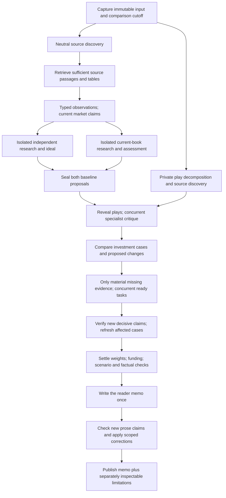

# Portfolio Evidence-to-Decision Uplift

**September 22:** live acceptance did not succeed. R360 failed and its recovery
was stopped after 8h30m20s without a final memo. See the [full reassessment and
revised work order](./portfolio-r360-run-audit-20260922.md#september-22-stop-decision-and-full-reassessment)
before using this original design as an implementation-complete checklist.
Decision-scoped workload, incremental source verification and nonblocking durable
persistence take priority. All U01-U17 remain explicitly accounted for there.

Status: Design baseline v0.1. Implementation and verification are tracked in [the implementation ledger](./portfolio-uplift-implementation-20260921.md). The tested implementation, including R01-R09 repairs, is deployed in Fly release 360. Broader design scope and a controlled paid comparison remain outstanding.

The [second-pass implementation review](./portfolio-uplift-second-pass-review-20260921.md) found nine reproducible defects and additional unfinished scope. R01-R09 are repaired, deployed and covered by regression tests; the wider design acceptance criteria below are not all met. The implementation ledger distinguishes those verified repairs from remaining scope and live evaluation.

## Objective

Produce a readable, independent and financially coherent portfolio memo whose conclusions actually use the research purchased for the run. Preserve useful output when individual work fails. Reduce elapsed time by removing false dependencies and repeated reasoning, not by cutting off model output or dropping relevant evidence.

Based on the [completed-run comparison](./portfolio-final-comparison-and-concurrency-20260921.md) and [second-pass audit](./portfolio-deep-audit-20260921.md). Finding identifiers D01-D12 refer to the latter. The first audit's independence, play coverage, funding, presentation and concurrency findings remain in scope.

## Non-Negotiables

1. The independent ideal must never see holdings, private company research, submitted plays or another allocator's answer. Save the independent and current-aware proposals before introducing plays into reconciliation.
2. The opportunity universe stays open. No fixed commodity, sector or exposure allowlist; no obligation to reproduce every current asset class in the ideal portfolio.
3. No new output-token ceiling, silent text clipping, automatic model substitution or mandatory extra generic review.
4. Keep original responses, source snapshots and prior proposals. Mark specific uncertainty; never discard a usable memo because of an optional field, supplementary search failure or small rounding difference.
5. Do not turn unknown evidence into a forced buy, hold or sale. Unsupported investment action stays explicitly provisional; useful reasoning remains readable.
6. Separate research truth, investment merit, portfolio fit and implementation readiness. The same caveat must not be copied into all four categories.
7. Preserve the established reader layout, light/dark modes and saved-memo access. This is primarily a pipeline and document-contract change, not a UI redesign.
8. Existing model choices and authorised research spending remain unchanged until explicitly adjusted. A budget estimate is not an account balance or a provider refusal.

## Proposed Flow

The private play branch can discover sources while the baselines run but cannot write into their evidence snapshots. If the product requires strictly sequential baseline generation, prepare the current-book research privately during the independent allocation call; it need not be idle.

No separate Codex VM, new agent framework or external workflow engine is required. Use the existing Python async runtime, checkpoint store and model-routing page. Introduce explicit contracts and immutable branch inputs, not another orchestration platform.

## Priority Ledger

The ledger below records the design scope. Current implementation status and verification are in the linked implementation ledger. Financial-outcome acceptance still requires the controlled comparison, not a prompt edit alone.

| ID | Priority | Change | Findings covered | Main ownership |
| --- | --- | --- | --- | --- |
| U01 | P0 | Preserve table and passage context; selectively inspect source documents | D01, D02 | Retrieval, source hydration, extraction |
| U02 | P0 | Typed observations and field-level evidence validity | D04, D05 | Evidence normalization and projection |
| U03 | P0 | Correct/supersede bad observations and propagate affected claims | D01, D04, D06 | Evidence, research relationships, judgment |
| U04 | P0 | Keep opposing evidence in every affected decision packet | D03, D06 | Research relationships, request selection |
| U05 | P0 | Refresh investment cases after material late evidence | D03, D09; first-audit absent-research finding | Research, settlement |
| U06 | P0 | Reliable review dispositions and scoped factual patching | D11 | Judgment, memo document contract |
| U07 | P0 | Separate funding arithmetic from economic similarity | First-audit funding; D09 | Exposure mapping, decision ledger |
| U08 | P1 | Reconcile plays with research priorities and spend | First-audit play findings; D02 | Play inventory, planner, research budget |
| U09 | P1 | Align market research with scope, horizon and geography | D07, D08 | Input adapter, research prompts |
| U10 | P1 | Require causal investment and expression comparisons | D08, D09 | Allocation and investment-case contracts |
| U11 | P1 | Make portfolio risk comparison operational and honest | D09, D10 | Scenarios, sizing, implementation comparison |
| U12 | P1 | Remove deferred-search barriers and phase-wide waiting | First-audit concurrency | Question scheduler, source processing |
| U13 | P1 | Isolate and overlap baseline branches safely | First-audit concurrency | Pipeline runtime and checkpoint state |
| U14 | P1 | Add provider-performance policy and latency telemetry | First-audit slow calls | OpenRouter client and runtime |
| U15 | P2 | Bind proposed monitoring to real series and conditions | D12 | Conditions and observation identity |
| U16 | P2 | Simplify repeated task output and restore editorial discipline | D06, D09, D11; first-audit readability | Request contracts and memo writer |
| U17 | P2 | Build frozen-case regression and comparative evaluation | All | Tests and audit tooling |

The P0 ordering follows the evidence path. P0 means correctness priority for this uplift, not a new runtime rule that blocks publication.

## U01: Sufficient Source Context

**Change.** Extend the existing source packet with evidence locator and completeness information: document version, page/section, table row and column headers, passage bounds, retrieval method, publication metadata and content hash. A nonempty excerpt is not automatically sufficient context.

For material table claims, prefer the publisher's structured download where available; otherwise use layout-aware PDF/table extraction. Preserve multi-row column headers with each selected row. Use visual/model-assisted table interpretation only for unresolved layouts, keeping page coordinates and provenance. Do not build a special parser for each commodity.

Before buying another search, ask whether an already-discovered document can answer the missing dimension. Retrieve the needed section plus relevant qualifications, not the whole website. Cache document sections by URL, version and locator; retain different snapshots rather than overwriting by URL alone.

**Acceptance.** The frozen World Bank page resolves Brent 82.6 to 2023 and 90.9 to August 2026. FactSet Energy research exposes the difference between aggregate sector, upstream and refining economics. A 705-character excerpt does not claim complete document coverage. A source fetch failure preserves the earlier excerpt with a specific limitation.

## U02: Observation Types and Honest Validity

**Change.** Replace the universal mandatory observation shape with a small discriminated observation contract:

- Quote: instrument/series, value, unit, quote time or date, quote convention.
- Period statistic: series, value, reference period, release date, seasonal/annualisation basis and revision where applicable.
- Forecast: author/model, value or range, target period, publication date, scenario and forecast vintage.
- Qualitative claim: proposition, subject, source passage, applicability and dated availability where established.
- Derived value: operand IDs, operation, dimensions and calculation provenance.

Retain `observed_at` compatibility for old artifacts, but do not invent a day for a quarter or call forecast publication an outcome observation. Add timestamp precision and timezone status. Missing timezone is not UTC. Separate financial currency from dimensionless ratios and from an instrument's reporting denomination.

Keep independent field states for value/period support, source availability, applicability, and metadata completeness. A missing release version on an unrevised market quote should not negate its value. A reviewer-confirmed non-applicable currency must be representable as such. A contradicted column assignment must remain materially different from a formatting omission.

Request projections must preserve the decisive reason for a limitation and its affected field, including supported dimensions where needed. Do not send only an unexplained `unsupported` label.

**Acceptance.** The run's P/E, percent-growth, quarter AISC and FOMC forecast fixtures remain usable at their actual support level without inventing metadata. Bad World Bank value/period pairs remain contradicted. The China site-time example stays temporally uncertain until an offset is established. Neither a future forecast target nor a date-only historical period is misclassified as future publication.

## U03: Correction Propagation

**Change.** Treat normalized observations and derived market claims as versioned records. A correction creates a reviewed replacement linked by `supersedes`; the raw original remains archived. A source checker may propose a replacement operand or period, but code applies it only with a valid source locator and explicit verification.

Maintain dependencies from observation IDs to research answers, market claims and investment cases. When an observation is corrected, mark affected current claims stale and refresh only those claims. Do not silently mutate the saved independent proposal; attach an updated premise assessment for later reconciliation.

A valid newly derived value receives a new identity and explicit aliases where the relationship is known. Reject nonexistent references locally as reference errors, preserve their surrounding text and request a bounded correction or retain it as unlinked. Never fuzzy-match a near-identical hash without proof.

**Acceptance.** Correcting the World Bank column removes the false August-price discrepancy from the current market view, Energy case and final citation selection. It does not rerun unrelated healthcare or miner research. Original drafts remain inspectable. The semiconductor typo and finding-as-fact references cannot be treated as verified citations.

## U04: Opposing Evidence Preservation

**Change.** Extend existing research-question relationships into a compact decision-relevant evidence set: supportive observations, contrary observations, different vintages/scopes, unresolved measurements and genuinely unavailable dimensions. Use explicit economic relationships, not substring matching or the fact IDs an early allocator happened to cite.

For copper, distinguish global refined balance, ex-US balance, mine supply, exchange curve and inventories. Surplus and deficit forecasts are members of the same comparison even when their metric names differ. Do not merge them into one consensus number or delete a less convenient forecast.

Scoped packets should include all material members of that comparison plus their source and metadata qualifications. If a decision packet cannot include an essential passage, expose a resolvable source handle and require its lookup before making a claim about that passage. A catalogue entry is not equivalent to having read the evidence.

**Acceptance.** Both named surplus forecasts survive into the final copper case and final claim checker alongside deficit forecasts. They are explicitly compared by date, geography and assumptions. Their presence does not force a bearish verdict. Unrelated facts remain outside the packet.

## U05: Evidence Must Change the Case Before It Can Confirm the Weight

**Change.** After targeted research, refresh the affected case before final settlement. The update must state what the new findings support, contradict or leave unresolved, and why the weight should change or remain justified. The saved original proposal is a reference, not a presumption of correctness.

A case has a stable ID, evidence-version dependency, purpose, causal mechanism, opposing case, pricing/valuation view, horizon and allocation implication. Reuse unchanged cases; invalidate only cases whose material dependencies changed. Avoid re-emitting the whole archive or adding a second generic reviewer.

Determine whether a dimension is absent, retrieved but unverified, materially contradicted, partially supported or decision-ready. Do not require every sub-dimension to be fully answered before summarizing what is established. Selectively check decisive new facts, including facts that challenge an existing view.

**Acceptance.** The 23 saved silver observations produce a silver case that acknowledges them. Gold-miner Q2 facts are used without demanding unavailable Q3 actuals. Copper cost research is not called absent. A retained 16% Energy target must explain its risk/cost trade-off after the corrected supply premise; unchanged weight alone is neither success nor failure.

## U06: Findings and Corrections That Actually Reach the Reader

**Change.** Bind reviewer findings to stable claims/target IDs and the document version reviewed. Allow grouped explanations only for genuinely shared issues; derive an individual resolution record for every affected claim.

Generate patchable prose paths from the same reader-document contract supplied to the checker. Include exclusions, market-pricing explanation and smaller-change rationale where they are part of that document. Keep numeric allocation changes outside text patches. Preserve exact-original matching or expected-content hashes to prevent stale writes.

Record a reason for every rejected patch: stale original, invalid reference, unknown path, unsupported field or numeric-change attempt. Classify duplicate/already-applied patches as superseded, not another unresolved defect. Recompute the relevant finding status after application. A model's `resolved` assertion is not sufficient if the referenced text or fact is still wrong.

**Acceptance.** The term-premium correction can reach the exclusion paragraph. A correction cannot move capital via prose. The same source-period error cannot survive while its finding is declared resolved. Checkers assess the latest smaller-change funding record, not a stale pre-repair diagnostic. A failed optional checker preserves the memo and labels the review incomplete.

## U07: Deterministic Funding and Comparisons

**Change.** Separate three concepts already conflated by `baseline_links`:

1. Position identity and capital attribution: what current weight actually exists.
2. Economic similarity or substitution: how exposures behave and serve a purpose.
3. Funding flow: which explicit reductions finance which additions.

Bullion can be a new position, partially share factors with miners, and be funded by selling miners without being the same capital. Require an explicit new-exposure declaration rather than interpreting a rejected similarity mapping as unknown current capital. Where the snapshot is not exhaustive, retain the uncertainty.

Compute current-to-target changes and funding in code from position/target IDs, not market fact IDs. Accept point-weight alternatives without fabricated ranges; ranges are a separate investment preference. Treat rounding tolerance independently from missing capital. Derive human-readable funding and status from the same ledger. Never describe a proposed allocation as traded or executed.

Use typed comparison operators: same-issuer/currency and matched maturity for nominal-versus-real yield comparisons, not equality of the nominal/real curve name. Bond maturity is not investment horizon or duration. Do not compute cash real return against mismatched inflation without a clearly labelled assumption.

**Acceptance.** The smaller-change fixture stays balanced at 8.6635% turnover. The bullion case has consistent current weight, target, funding and trade status or one specific unresolved identity issue. Energy weight subtraction uses the original allocation operands. The 0.0054pp residual does not invalidate otherwise valid reasoning or trigger a broad rerun.

## U08: Complete Play Coverage Without Unbounded Research

**Change.** Freeze semantic components before dispatch and reconcile every submitted component against existing evidence and proposed questions. An invented copper component cannot displace fertiliser or uranium. Broad play-level questions apply to a leg only through an explicit causal relationship; absent component IDs must not mean every leg inherits every question.

Prioritize by decision relevance, affected capital/risk and whether evidence could change the choice. Reuse source documents and measurements first. Reserve research for material submitted components and proposed additions before discretionary secondary themes consume the allowance. This is not a quota of one paid call per commodity: multiple legs may share a relevant source, and some may need no new search.

Keep the spending allowance explicit and distinct from provider credits. Report the resulting research plan and any meaningful trade-offs. A funded account does not silently increase an application allowance; an allowance does not prove the provider cannot accept a call. Pause only the additional paid discovery if approval is required, while completing the memo with existing evidence.

**Acceptance.** All six actual components have a source-backed assessment or a precise deferred question and reason. Scores remain separate from confidence and incremental action. Gold/oil caveats do not inherit fertiliser/copper gaps. Partial retrieval failure preserves successful legs. No automatic blanket calls for every holding.

## U09-U11: Financial Analysis Contract

### Match the investor and the economic exposure

Carry the supplied high/5+ year settings without converting them into an invented numerical drawdown limit. Identify whether the analysis is allocation-only and whether portfolio scope/base currency are unknown. Obtain those from existing account settings if genuinely available; otherwise keep implementation conditional. Do not add a large compulsory questionnaire.

Research both the structural holding-period thesis and shorter catalysts. US macro relevance does not make US sector multiples representative of every global or Australian holding. Emerging markets are not equivalent to MENA. Distinguish producers, developers, refiners, service firms, broad sector funds and direct commodity exposures when it affects the conclusion.

### Require a decision-relevant causal chain

Use a consistent analytical structure, with domain-specific questions generated from the case rather than a fixed allowlist:

`physical/economic change -> beneficiary exposure -> revenue and cost transmission -> cash flows/capital needs -> valuation and priced expectations -> scenario returns/risks -> portfolio purpose and size`

Every link need not be numeric. State what is observed, what is assumed and what could falsify it. Compare with a credible alternative and doing nothing. Do not conclude that lower battery costs guarantee higher manufacturer equity returns, that low cyclically inflated P/E means cheapness, or that aggregate sector earnings establish a small producer's margins.

For scarcity plays, examine second-order input costs and offsetting supply response. For hedges, compare the specified adverse event rather than standalone yield alone. For commodity futures, account for collateral, notional exposure, roll and implementation; for bond funds, distinguish continuing duration from a held-to-maturity ladder.

For the gold-versus-bonds play, distinguish fiscal-confidence repricing, inflation/financial repression, liquidity stress and disinflation. TIPS remove neither sovereign exposure nor investor FX risk. A future adverse event need not have already occurred for insurance against it to be worth considering; assess its plausible transmission, current pricing, hedge failure cases and cost. Equally, a large debt stock alone does not prove yields must rise or gold must outperform.

### Size with explicit portfolio trade-offs

Use the current book, independent ideal, smaller-change option and final candidate as distinct alternatives. Explain material weight choices and tipping conditions; do not mechanically average the two baselines or force a particular number of sleeves. Where precise optimisation is not supported, use a justified indicative target/range and disclose sensitivity.

Create the scenario inputs currently missing between research and comparison. Prefer sourced market starting points plus explicitly labelled scenario assumptions. Include the material common-factor risks of the actual proposals, not an exhaustive mandatory scenario catalogue. Show qualitative comparison when sensitivities are unavailable; use bounded sensitivity ranges where defensible. Never infer beta or correlation from a sector name.

Keep copied external forecasts distinct from the memo's own conditional judgments. An accountable thesis needs observable invalidation conditions, not a spurious point-return forecast for every exposure.

**Acceptance.** The oil fixture distinguishes upstream/refining and cyclical versus structural supply effects. Copper reconciles balance scope before using roll/return assumptions. Clean energy cannot simultaneously be presented as an established allocation and a case for which cash is preferable without explaining the deliberate option-like position. TIPS explains vehicle and currency uncertainty. No quantified downside claim appears without its assumptions and calculation. Unknown inputs do not prevent a useful asset-class memo.

## U12-U14: Scheduling and Latency

### Ready-task execution

Dispatch all affordable independent first-pass questions without withholding a slot until an entire wave completes. Expansion depends on its own unresolved result, not unrelated questions. Process completed source discoveries through idempotent hydration/extraction immediately; do not wait for the slowest lane before starting all processing.

Use atomic budget reservation and request identity before submission. Persist provider task IDs and each question result independently. A timed-out local waiter must not trigger a second paid task when the first provider task is still running. Stop scheduling dependent work only when it truly lacks usable input.

### Private baseline branches

Replace shared mutable `evidence`, `plays`, `citations` and progress scope with branch-local snapshots and output references. Merge permitted evidence deterministically after both baselines are sealed. Source caching can be shared, but a cache hit must not grant another branch access to private research.

Use bounded concurrency and memory-aware admission. The existing semaphore permits four model requests; raising it alone is not the solution. Checkpoint branch completion and evidence versions so resume cannot combine mismatched baselines or rebuy completed tasks.

### Serving-provider policy

Keep the chosen model; add explicit performance preferences with fallback for long-generating tasks where the provider API supports them. Record queue duration, time to first token, output rate, serving provider, response completion reason and total cost. Compare like workloads before selecting a default. Do not promise a fixed time, blacklist a provider on a single sample, terminate a productive long call or reduce output quality to hit an arbitrary timeout.

**Acceptance.** Two independent research questions overlap; private branches pass holdings/play leakage sentinel tests; resume makes no duplicate paid submission. A dependency trace identifies why each waiting task is blocked. The original run's roughly 81-minute theoretical overlap opportunity is a test hypothesis, not a promised saving. Provider policy and task-contract changes require measured latency/quality/cost comparison.

## U15: Monitoring That Can Be Evaluated

Each machine-evaluable condition needs a stable ID, canonical series binding, unit/sign convention, threshold, freshness rule and any required persistence or sequence. Bind through validated mappings, not arbitrary text matching. Keep the human-readable title separate.

The copper example must distinguish a positive contango magnitude from a cash-minus-forward spread. Consecutive manufacturing declines require a sequence operator; sustained prices require an interval or count, not one latest quote. Do not attach live monitoring or recurring paid retrieval without user intent.

**Acceptance.** Frozen observations evaluate supported conditions correctly, or give a concrete reason such as missing series, stale observation or undefined persistence. Null-ID conditions cannot be represented as operational. The same saved copper quote cannot trigger opposite interpretations after a cosmetic label change.

## U16: Less Repetition, Better Memo

Specify the analytical output each role owns. The independent allocator writes the strategic portfolio and concise decision cases; specialist work extends only material cases; the writer communicates the settled view. Do not require every role to repeat the research assessment, excluded opportunity universe, alternative portfolio and full audit.

Keep a current, standalone executive view and a short theme field distinct from its explanation. Put revision history, failed-patch diagnostics and technical provenance at the end or in the existing supporting section. Do not leak instructions such as preserving decisions or avoiding regeneration into the reader memo. Qualify only the claim affected; avoid the same question list below every asset.

Preserve useful long-form reasoning in the archive. Reduce duplicated obligations and source repetition rather than adding a token ceiling or truncating text to fit a layout.

**Acceptance.** Compare the same saved content at desktop/mobile sizes using the established reader. The theme cannot stretch the summary column into a long essay; the executive view states the current investment judgment, not the correction history. Main narrative, table, play outcomes and implementation status agree.

## U17: Verification and Rollout

### Step 1: Freeze evidence and current behavior

Keep this completed artifact and selected retrieved primary passages as regression fixtures. Protect raw data from test mutation. Preserve the two baseline proposals for recovery tests. Store a before/after issue register with severity and disposition, not just a composite score.

### Step 2: Correctness work, offline first

Implement U01-U07 in small scoped changes. Replay normalization, reference resolution, coverage projection, patch application and accounting against saved fixtures without provider calls. Tests must cover both real contradictions and harmless missing metadata. Test that unrelated useful output survives partial failures.

### Step 3: Research and financial handoffs

Implement U08-U11 and U15 using mocked planner/allocator outputs and saved opposing facts. Test source coverage, play completeness, horizon applicability, scenario provenance and retained-weight explanations. A finding is resolved only if the emitted case is correct, not because a prompt contains a warning about it.

### Step 4: Concurrency and document output

Implement U12-U14 and U16 with a deterministic fake-provider scheduler. Verify branch isolation, budget races, bounded memory, crash/resume and no duplicate submissions. Render the memo in desktop/mobile and both themes. Keep existing saved memos readable.

### Step 5: Controlled paid comparison, after authorisation

Run one controlled comparison using the same portfolio, plays, high/5+ year mandate and explicit spending envelope. Distinguish tests reusing frozen evidence from tests buying new research; they measure different things. Do not compare changes in market dates as though they were purely architecture improvements.

Report: material factual defects, contrary-evidence retention, play resolution, funding consistency, scenario assumption quality, readable narrative, paid request count, retries, reused calls, tokens, provider cost and critical-path time. A run with unchanged weights may pass; a faster run with a falsely supported allocation must not.

### Publication behavior

These are release acceptance tests for our code, not a new all-or-nothing runtime gate. Production should still publish a useful memo with specific limitations when evidence or a supplementary provider is unavailable. It must not present unresolved investment actions as verified execution or claim a review passed when it did not.

## Open Product Decisions

- Confirm whether portfolio scope and base currency can be read from existing terminal settings. Do not infer them from the user's location or ticker exchange.
- Decide the visible default research-spend allowance and how to present material unresearched plays before optional extra spend. Do not silently increase the allowance during this uplift.
- Choose a measured latency objective after scheduling replay; do not advertise a 20-30 minute run based on this five-hour trace.

None of these decisions blocks the offline correctness work. They must be explicit before altering spending or claiming investor-specific suitability.
