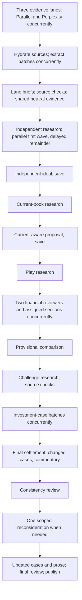
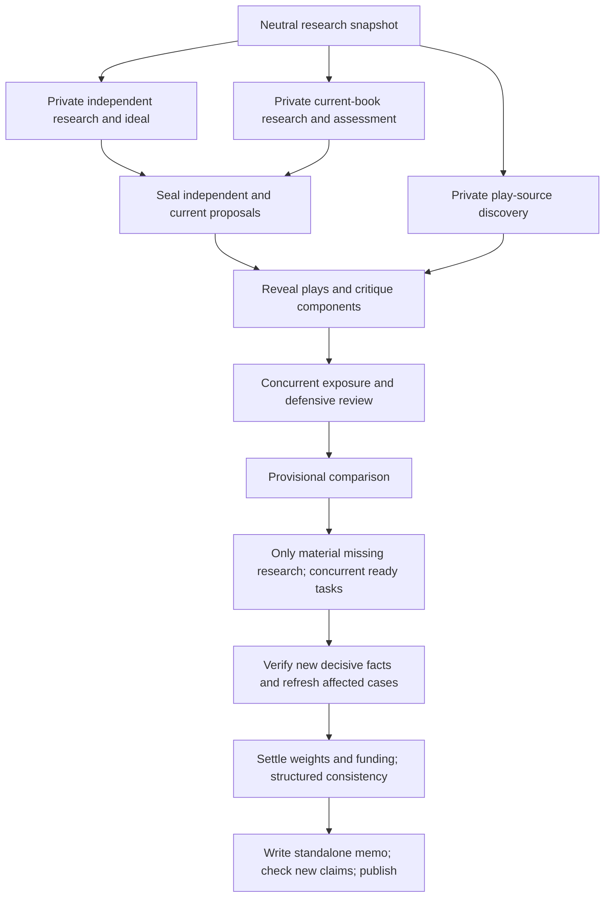

# Portfolio Memo: Completed-Run Comparison and Concurrency Audit

## Verdict

**The infrastructure improved more than the investment memo. The latest completed memo is approximately 6.5/10 overall: a modest improvement over the previous completed recovery, not the strongest reading experience and not an implementation-ready portfolio.**

The independent view is genuinely independent, original research survives recovery, important financial corrections reach the main document, and partial outputs no longer disappear. However, purchased research is still described as absent, funding prose contradicts recorded accounting, play coverage is incomplete, and the executive section reads like a correction log. More facts and more review passes have not produced commensurately better judgment.

The runtime is **not entirely serial**, but approximately **72% of the original run had only one provider request active**. It already permits four concurrent model calls. Raising that limit alone would not fix the long dependency chain, deliberately delayed search waves, slow serving providers or oversized task contracts.

## Scope and Method

- Completed recovery: `portfolio_positioning_job_portfolio_recovery_20260921_085131.json`, job `c39a17da-707c-4f74-bbc0-029f931744de`.
- Original fresh run: `portfolio_positioning_job_portfolio_high_risk_long_term_20260921_20260921_022441.json`, job `2e7fd841-6792-4494-ba40-84ea43b957a7`.
- Original execution: September 21, 12:24:41 to 17:42:08 Melbourne, **5h17m27s**, then stopped by the faulty credit estimate.
- Recovery: 18:51:31 to 18:58:28, **6m57s**, retaining 130 completed tasks and making only the final Opus request. The intervening 69-minute repair/deployment gap is not provider analysis time.
- Original plays and High / 5+ years mandate are unchanged. Recovery preserved the evidence, independent proposal and current-aware proposal exactly.
- Read-only artifact/code inspection, saved request timestamps and payload inventories, and six browser comparisons using the deployed reader with unchanged saved memo fixtures at 1440px and 390px. No paid model call, deployment, model change or production-data modification during this audit.
- Comparisons are not controlled investment backtests: dates, research, models and mandate inputs differ. Scores are subjective analyst-document judgments. Historical scores are carried forward from the earlier saved audits; the latest is assessed after completion, not from its interim draft.

[Completed memo](https://llm-council-analysis.fly.dev/portfolio-analysis?run_id=portfolio_positioning_job_portfolio_recovery_20260921_085131.json).

## Ranking

Overall weights financial usefulness and material defects more heavily than visual polish; it is not a simple average.

| Completed memo | Readability | Formatting | Financial analysis | Overall quality |
| --- | ---: | ---: | ---: | ---: |
| Legacy August | 8 | 8 | 6.5 | 7 |
| Latest High / 5+ years | 6 | 5.5 | 6.5 | 6.5 |
| September 19 remediation | 4 | 5 | 7 | 6.5 |
| Previous DeepSeek recovery | 7 | 6.5 | 6 | 6 |
| Ling/Opus replay | 6 | 5 | 7 | 6 |
| Legacy April | 8 | 8 | 5 | 5.5 |

August remains the best reading experience, not the best verified architecture. Its legacy synthesis had its own fallback and integrity limitations. The September 20 fresh run stopped before its final consistency review and is excluded from completed-memo ranking.

The latest is stronger than the previous recovery in independence, research retention and selected financial corrections. It is worse in editorial focus and top-of-page presentation. Neither a higher nor a lower commodity weight is evidence of superior analysis by itself.

## What Improved

### Independence and the mandate are real

The independent proposal has **nine** positive exposures; the current-aware proposal has **18**. The final has **24**, including smaller inherited holdings retained under review and new exposures from the independent view. The independent model does not simply mirror the current 17 categories.

The high-risk preference is considered without treating it as an instruction to maximise losses. The long horizon appears in the copper, grid and real-duration reasoning. This is input delivery and explicit use, not proof that the exact weights are optimal. Much of the actual supporting outlook still concerns the next quarter or year; a five-year label does not make it a five-year investment case.

### Corrections reached the main memo

- The oil argument now reads IEA demand alongside supply contraction and inventory draws. It no longer uses the demand headline by itself as a net-bearish oil conclusion. The Energy trim is instead presented as a concentration decision.
- The TIPS discussion now rejects comparison of ten-year CPI breakevens with one-year PCE and spot CPI as proof of clean mispricing. This matches the [Federal Reserve's same-maturity definition and discussion of risk premia](https://www.federalreserve.gov/data/tips-yield-curve-and-inflation-compensation.htm).
- Bullion is differentiated from miner equities, and cash from bills. Unknown research does not automatically force exits across the small sleeves.
- Useful responses survived a source-review connection interruption. The final review completed after a one-call recovery, without rebuying research or regenerating allocations.

### Request volume fell, but elapsed time did not

| Measure | September 20 fresh attempt, incomplete | Latest original plus final recovery |
| --- | ---: | ---: |
| Reported input tokens | 6,068,034 | 3,292,973 |
| Reported completion tokens, including reasoning | 1,289,219 | 977,402 |
| Requests above 100k input tokens | 25 | 11 |
| Application retry requests | 6 | 0 |
| Stored observations | 578 | 665 |
| Source entries | 100 | 102 |

Inputs fell approximately **45.7%** and completion tokens **24.2%**, despite the latest including its final review. This supports the request-redesign diagnosis. It does not isolate the effect of each code change; research content and mandate differ.

There was **one recorded 502 connection interruption** during source review. The usable partial response was retained with eight unresolved fact checks, without retrying. There was also the later application credit stop. Zero retries does not mean zero provider interruptions.

The original and recovered histories contain 113 unique model requests and 18 retrieval requests: 15 Parallel Ultra2x tasks and three Perplexity requests. Approximately **$9.32** of OpenRouter cost is reported across both histories; one interrupted call has no usage receipt. Parallel discovery reserved an estimated **$9**, not an invoice. Perplexity and other extraction charges are separate. The recovery's $2.20 is not the total run cost.

## Material Remaining Findings

### 1. Research is present but the final decision still calls it absent

This is different from the previous recovery losing 203 observations. The new observations survive and are included in the final requests, but are not reliably incorporated into the investment conclusions.

| Subject | New focused observations saved | Included in final settlement, writer and both consistency checks | Published problem |
| --- | ---: | ---: | --- |
| Silver | 23 | 23 | Says no silver price, demand, supply or inventory evidence was supplied |
| Copper miners | 66 | 64 | Says no C1/AISC, production guidance or capex evidence was supplied |
| Gold miners | 66 | 57 | Still asks for Q2/Q3 costs without properly distinguishing supplied Q2 data from unavailable Q3 actuals |
| Rare earths | 35 | 27 | Says no rare-earth prices, export controls or ex-China capacity evidence was supplied |

Examples from saved research:

- Silver: spot price, a forecast 46.3 Moz deficit, industrial/PV demand, byproduct dependence, inventories and Pan American operating economics. The [Silver Institute's April release](https://silverinstitute.org/elevated-lease-rates-regional-liquidity-tightness-and-robust-investor-interest-resulted-in-record-silver-prices-in-2025/) independently confirms that a 46.3 Moz deficit forecast exists. This is not proof that every saved number or miner valuation is correct.
- Copper miners: First Quantum Q2 C1 costs of $2.54/lb and 2026 AISC guidance of $3.50-$3.80/lb, alongside other producers' guidance and capital spending.
- Gold miners: representative Q2 AISC of $1,459-$1,866/oz and realised gold prices of $4,414-$4,483/oz; Q3 actuals were unavailable at the cutoff.
- Rare earths: supply-chain concentration, ex-China separation/magnet capacity and dated export-control distinctions.

Some of these observations remain unverified or have imperfect metadata. That warrants qualification, not the assertion that the research was never supplied. Source-based facts, verified facts and decision-ready conclusions are different states.

**Concrete architectural contributors:**

1. Source review is initially restricted to facts linked by the old ideal, current proposal, provisional recommendation and reviews. Newly acquired contrary or previously missing facts can reach final models without a completed source check. See [selected-fact review](/Users/Toms_Macbook/Projects/llm-council/scripts/portfolio_positioning_memo.py:3178).
2. Coverage matches answer dimensions by normalised text and degrades an entire dimension if any referenced fact has a disallowed verification issue. Missing observation dates on forecasts can therefore obscure their valid forecast/reference-period information. See [coverage](/Users/Toms_Macbook/Projects/llm-council/backend/portfolio_research.py:279).
3. All 21 final research questions still have empty `dimension_measurements` arrays. Measurement-level reuse exists in code but did not become operational on this generated plan.
4. Final models receive old coverage claims alongside hundreds of new observations. There is no demonstrated, reliable transition from changed evidence to a refreshed claim about what is known. The final reviews themselves miss this mismatch.

The appropriate fix is not another full generic review. Publish a per-question evidence update identifying newly supported, contrary, unavailable and unverified dimensions; verify decision-critical new facts; explicitly refresh the affected investment case and its coverage wording before settlement. Keep the earlier independent proposal archived unchanged.

### 2. Play research is still incomplete and misallocated

| Component | Published score | Treatment | Audit |
| --- | --- | --- | --- |
| Fertiliser | Not assessed | Deferred | No focused search was purchased |
| Gold miners | 6/10 provisional | Trim to 10% | Better cost research exists than the displayed discussion suggests |
| Silver miners | Not assessed | Trim to 3% | Research was purchased, but the memo calls it absent |
| Oil producers | 6/10 provisional | Trim to 16% | Stronger physical-market reasoning; valuation/benchmark bridge remains uncertain |
| Uranium producers | Not assessed | Retain 0.82% under review | Focused research deferred by the internal discovery allowance |
| Physical gold relative to bonds | 7/10 provisional | Add 4% bullion; retain TIPS and bills | Debated, but sovereign/fiscal premise and implementation are incomplete |

The five-leg scarcity play received a parent score of 5/10. The second play is not treated as a short-bond instruction, which is appropriate.

The dedicated play planner omitted fertiliser, silver and uranium and assigned copper to the scarcity play, despite copper not being a submitted component. Later challenge research recovered silver coverage but did not complete fertiliser or uranium. The component-identification fallback did not repair the dispatch plan.

The $9 discovery allowance was exhausted. Its initial lanes consume $1.80; subsequent work is distributed through phase fractions and task-order decisions. This is an **internal research-spend allowance**, not a statement that the provider account ran out of money. Prioritisation must reconcile submitted components and material portfolio decisions, rather than spend the remaining allowance on whichever questions happen to appear first.

There is also an exact mapping defect: when a question has a play ID but no component IDs, [qualification](/Users/Toms_Macbook/Projects/llm-council/backend/portfolio_research.py:466) attaches it to every leg. Gold and oil ratings consequently inherit copper, uranium and fertiliser questions in their displayed caveats. That is not evidence that all those subjects are prerequisites for each rating.

### 3. Funding and precision remain contradictory

The memo repeatedly says bullion is funded by miner trims, and even describes funding as executed. Its recorded accounting still marks the bullion holdings relationship unresolved and cannot establish the destination turnover. No trades were executed by this analysis.

Economic similarity, existing position identity and the source of funding are distinct relationships. Bullion and miners can share risk factors without being the same position. Selling miners can fund bullion without claiming capital equivalence. The current relationship representation and generated prose have not resolved those distinctions consistently.

Targets total **99.9946%**, not exactly 100%. The 0.0054 percentage-point residual is economically immaterial and is not a reason to discard the memo. The material issue is asserting a verified funded transition that the recorded position mapping does not establish. The small discrepancy and the large semantic uncertainty must not be treated as equivalent failures.

The latest final review also leaves all four recorded calculations unresolved. An Energy weight calculation cites a copper-import observation and an earnings-growth observation, instead of referencing the original portfolio weights. Portfolio arithmetic should use typed position inputs; it should not require a market-source fact ID for a weight subtraction.

### 4. More caveats have not created stronger portfolio sizing

The same corrected oil premise leaves Energy at 16%. That can be reasonable if concentration dominates, but a stated preference for diversification does not quantitatively establish 16% rather than 20% or 24%. Silver falls from 8.9% to 3% and pharma from 14.3% to 7% without sufficiently developed scenario or company-level economics.

The memo says that bands, liquidity and residual cash bound downside. They do not constitute a quantified loss bound. It supplies no usable joint stress comparison to demonstrate how the proposed book behaves when growth and inflation both fall, real yields rise, or commodity prices normalise. The 5+ year profile also does not automatically match a 5-10 year bond ladder or settle tax, currency, liquidity and whole-wealth versus thematic-sleeve scope.

The framework is more cautious about unsupported precision, but it still uses precise weights to express judgments it has not adequately explained. Preserve model discretion; require the named risk assumptions and portfolio trade-offs supporting material changes, not a mechanically equal-weighted answer.

## Readability and Formatting

Same current deployed reader, unchanged saved artifacts, light mode:

| Measure | August | Previous recovery | Latest |
| --- | ---: | ---: | ---: |
| Full memo words including research and sources | 4,607 | 17,235 | 21,334 |
| Default visible reader words | 4,231 | 5,117 | 4,770 |
| Desktop memo height | 8,343px | 12,051px | 13,122px |
| Mobile memo height | 17,579px | 23,344px | 24,216px |
| Longest visible paragraph | 192 words | 100 words | 96 words |

No JavaScript exceptions, literal object-render artifacts or horizontal memo-panel overflow occurred in these six comparisons. Expanded supporting research makes the latest document 42,310px on desktop and 90,693px on mobile.

The latest has sensible section order and manageable paragraphs, but is less selective. The primary-theme field has become a long bold discussion in the right-hand summary column, stretching the first section and leaving a large blank area beneath the executive text. August uses the same layout more effectively because its theme is a short statement.

The executive view begins with what was corrected and which decisions are preserved. A new reader needs the current investment view, its reasons and its principal risks, not an account of how the system amended its own output. Instructions such as not regenerating the portfolio and references to a dynamic balancing plug still leak into the document. Repeated research questions interrupt otherwise useful investment discussion.

Preserve the established page layout. Improve the writer's editorial contract: distinct short theme and explanatory body, a fresh standalone executive narrative, relevant component-specific caveats, and audit/revision history outside the memo. This is not a recommendation to truncate model output or hide substantive uncertainty.

## Where the Time Went

Phase spans measured from first dispatch at each boundary; waiting inside a phase is included. Values are rounded, not additive provider CPU time.

| Original execution phase | Minutes |
| --- | ---: |
| Initial discovery, extraction, briefs and reconciliation | 31.3 |
| Independent premise research | 54.7 |
| Independent allocator | 52.8 |
| Current-book research | 35.7 |
| Current-aware allocator | 16.9 |
| Play planning and research | 28.0 |
| Concurrent financial reviews and their lookups | 12.1 |
| Provisional comparison | 2.9 |
| Challenge research and source checks | 48.0 |
| Investment cases, final settlement and first commentary | 14.0 |
| Consistency review, scoped reconsideration and updated prose | 21.0 |
| **Original run** | **317.5** |

Final one-call recovery adds 7.0 minutes of execution. The total original-plus-recovery execution is therefore about **5h24m**, excluding the repair/deployment gap.

### Measured concurrency

Unique provider request intervals are deduplicated by request ID; a partial response's failed and retained receipts are not counted as two calls.

- One active request: **228.35 minutes**, approximately 72% of the original request span.
- Two or more active requests: approximately **84.7 minutes**.
- No active recorded request: approximately **4 minutes** within that span.
- Maximum observed: six simultaneous requests, including retrieval. Model concurrency is capped at four by a semaphore.
- Summed overlapping request duration: **535.9 minutes**, versus a 317.1-minute span. Existing concurrency already saves substantial time; it simply leaves too much work serial.

Request intervals include provider waiting and local transport/finalisation; they do not prove every second is active inference. These measurements nevertheless do not support checkpoint disk I/O as the dominant explanation for five hours.

### Slow provider assignments

| Request | Input tokens | Output tokens | Elapsed | Serving provider |
| --- | ---: | ---: | ---: | --- |
| Independent allocator | 107,695 | 46,432 | 52.7 min | Sail Research |
| Consumer-credit extraction | 2,383 | 11,791 | 22.0 min | Morph |
| Current-aware allocator | 126,106 | 25,518 | 16.9 min | DigitalOcean |
| Sector-valuation extraction | 3,018 | 6,373 | 15.2 min | Morph |
| First final consistency review | 294,315 | 36,961 | 8.4 min | Claude Platform on AWS |

The independent request generated 18,728 reasoning tokens and about 27,704 other completion tokens. This is not only hidden reasoning. Its saved output includes extensive per-target cases, a research assessment, excluded opportunities, market questions, monitoring triggers and forecasts; later stages ask for investment details again.

The OpenRouter client has no explicit provider performance preference: [payload construction](/Users/Toms_Macbook/Projects/llm-council/backend/openrouter.py:74). [OpenRouter documents price-prioritised default routing and optional throughput/latency preferences](https://openrouter.ai/docs/guides/routing/provider-selection). Choosing DeepSeek Flash does not choose a predictable serving endpoint. The observed provider speeds are not a controlled benchmark, but they justify adding a measured performance policy rather than accepting arbitrary multi-minute variance silently.

## Current Architecture



This is a bounded workflow, not an infinite recursion. But a long series of dependent phase-wide waits is still expensive.

### Concrete avoidable serialisation

1. **Isolated portfolios run one after the other.** The current-aware prompt does not need the independent answer, yet the orchestration waits for it before even starting current-book research. [Main sequence](/Users/Toms_Macbook/Projects/llm-council/scripts/portfolio_positioning_memo.py:3114).
2. **A reserved search slot becomes an unnecessary full-wave wait.** The scheduler withholds one affordable distinct question, waits for every first-wave search plus extraction and answer to finish, then starts that deferred question. With a two-task allowance, it deliberately runs only one initially. In this run, oil research completes before gold research starts. [Search waves](/Users/Toms_Macbook/Projects/llm-council/scripts/portfolio_positioning_memo.py:2859), [serial remainder](/Users/Toms_Macbook/Projects/llm-council/scripts/portfolio_positioning_memo.py:2907).
3. **Expansion is serial across questions.** Each expansion needs its own preceding result, but unrelated expansions do not need each other's results. They currently execute in an awaited loop.
4. **Initial source processing waits for the slowest discovery lane.** All discovery completes before shared hydration and extraction begins. Streaming completed sources into an idempotent extraction queue would overlap the phases while still deduplicating sources. [Initial ensemble](/Users/Toms_Macbook/Projects/llm-council/scripts/portfolio_positioning_memo.py:1339).
5. **The first writer runs before the first claim audit.** Material corrections then require revised prose and another full settled-document review. The bounded correction is legitimate, but structured financial checks should precede the principal reader draft where possible. A final prose-consistency check can then concentrate on new assertions.

Do not simply wrap the present top-level phases in `gather`. `research_phase` mutates shared `evidence`, `plays`, `citations`, and progress scope. Naive parallelisation would risk leaking the holdings/play research into the blind view, nondeterministic merges and budget races.

## Recommended Architecture



The information boundary is the important property: the independent model never sees holdings or plays, and neither baseline sees the other's answer. Both proposals are saved before ideas can influence their comparison. Play research may be prefetched privately but cannot enter either baseline's evidence snapshot. If strict chronological generation is retained, privately preparing current-book research while the independent model works still overlaps useful work.

Implementation should use branch-local immutable input snapshots and separately checkpointed output references, a shared idempotent source/measurement cache, and explicit dependency nodes. Publish a deterministic merged evidence version only at a permitted boundary. The existing Python async runtime can support this; another VM does not remove these dependencies.

### Prioritised changes

| Priority | Change | Acceptance evidence |
| --- | --- | --- |
| P0 | Distinguish absent, retrieved, source-checked, contradictory and decision-ready evidence; refresh affected claims when late research arrives | Saved silver/copper/gold/rare-earth examples cannot be described as no research; unresolved metadata does not erase valid forecast/reference-period content |
| P0 | Separate current position identity, economic similarity and funding transactions; derive numeric comparisons from position data | Bullion addition has one consistent current weight, funding source and reader status; small rounding residuals do not fail the memo |
| P1 | Reconcile submitted play components with planned questions and materiality before buying research | Every component has reused evidence, a focused task, or an explicit materiality/funding reason; no invented copper component; gaps stay component-specific |
| P1 | Dispatch all affordable first-pass questions without the reserved-slot barrier; run independent expansions when ready | A two-question plan demonstrates overlapping requests; atomic reservations and idempotency prevent duplicate spend |
| P1 | Add explicit provider performance preferences for long-generating tasks, preserving chosen models and fallback | Record provider, queue/first-token/output timing, total cost and quality for comparable requests; no automatic mid-call cancellation or duplication |
| P1 | Run the independent and current-aware branches concurrently with isolated snapshots | Sentinel holdings/play information cannot appear in the independent request; neither baseline sees the other; resume retains both unchanged |
| P2 | Separate strategic allocation output from later investment-case detail and audit commentary | No repeated full research assessment in each role; changed decisions receive changed evidence rather than the whole historical document; no output clipping |
| P2 | Finalise structured decisions before writing; keep correction history out of the executive view | One coherent narrative, short theme, matching numbers and only relevant caveats; preserve the existing reader layout |

### Expected latency impact

The measured independent research plus allocation path is approximately 108 minutes; the current-book path is 53 minutes; play research is 28 minutes. Their existing combined serial span is about 189 minutes. Running isolated branches concurrently could remove roughly **81 minutes** from that span **under unchanged-duration, no-resource-contention assumptions**.

That is a scheduling opportunity, not an ETA: the model semaphore, provider throughput and network load can change when jobs overlap. Even this optimistic overlap leaves roughly four hours of original-plus-recovery execution at observed provider speeds. Therefore concurrency alone is insufficient. The search-wave waits, slow endpoints, repeated detailed output and evidence-to-decision handoff must also improve.

There is no defensible promise of a 20- or 30-minute run from this trace alone. Set a measured latency target after replaying the dependency schedule and running a controlled provider-performance comparison. Do not recover speed by silently truncating output, discarding late findings or converting unanswered research into automatic sells.

## Evidence and Reproduction

- [Audit inputs and derived results](/Users/Toms_Macbook/Projects/llm-council/outputs/audits/portfolio-final-review-20260921).
- [Latest published memo text](/Users/Toms_Macbook/Projects/llm-council/outputs/audits/portfolio-final-review-20260921/latest.md).
- [Unique request timing data](/Users/Toms_Macbook/Projects/llm-council/outputs/audits/portfolio-final-review-20260921/timings.json).
- [Browser measurements](/Users/Toms_Macbook/Projects/llm-council/outputs/audits/portfolio-final-review-20260921/browser/metrics.json).
- [Latest desktop screenshot](/Users/Toms_Macbook/Projects/llm-council/outputs/audits/portfolio-final-review-20260921/browser/latest-1440-top.png) and [August comparison](/Users/Toms_Macbook/Projects/llm-council/outputs/audits/portfolio-final-review-20260921/browser/august-1440-top.png).

```sh
.venv/bin/python outputs/audits/portfolio-final-review-20260921/audit.py
node outputs/audits/portfolio-final-review-20260921/browser.mjs
```

The browser script blocks non-GET API requests and supplies fixture responses; it does not start or modify analyses. This audit makes no claim that every market observation was independently reverified. The principal findings are evidenced by the saved run's own research, dispatch inventories, final text and accounting, with selected primary-source checks linked above.
