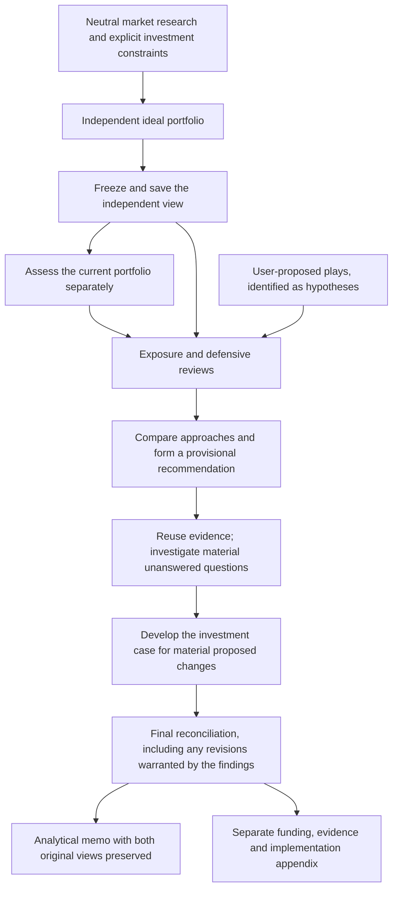

# Portfolio Memo Uplift: Independent View, Portfolio Assessment And Investment Plays

Status: implemented locally on `codex/portfolio-independent-memo`; offline validation completed. Not deployed. Controlled live model comparison and user review remain release gates.

Date: 18 September 2026 AEST.

Basis: the [architecture divergence audit](portfolio-architecture-divergence-audit-20260918.md) and the requirement to restore a research-led ideal portfolio before considering the user's holdings, while assessing user-proposed investment plays without automatically endorsing them.

## 1. Product Objective

The memo should answer three different questions, in this order:

1. **What portfolio would we choose from the research, starting without this portfolio?**
2. **What do we think of the portfolio actually held?**
3. **What, if anything, is worth changing after comparing those views and testing additional ideas?**

These answers must remain separately readable and separately saved. The final recommendation must explain where they agree, where they differ, and why. It must not quietly replace the independent ideal with a rearrangement of the current holdings.

An existing holding earns an assessment, not an automatic place in the ideal portfolio. A new idea earns consideration, not an automatic allocation. A proposed change must be better justified than leaving the portfolio alone.

The product remains an analyst's portfolio-shape memo. It is not a trade execution system or a requirement to collect a complete investment mandate before expressing a market view.

## 2. Diagnosis To Address

The current macro-first call has not disappeared: `_run_pipeline` still calls it before portfolio-aware work and passes an empty snapshot. However, that is insufficient isolation:

- `_build_asset_class_vocabulary` derives its catalogue from the input portfolio's `available_asset_classes`, falling back to its current `asset_classes`.
- That same catalogue is supplied to evidence coverage and the macro-first prompt. Portfolio-derived categories can therefore influence both what is researched and what the independent allocator considers.
- The final workflow merges the independent proposal into a current-portfolio funding ledger rather than preserving it as a first-class view for the reader.
- Every current sleeve must be accounted for, but the output does not clearly distinguish this accounting obligation from the decision to recommend it.
- The present renderer omits much of the strategy, implementation, monitoring and commentary content that was generated.

There is no evidence of a literal rule requiring the number of targets to equal the number of current asset classes. The failure is structural anchoring and conflation, not a proven hard-coded count rule. The uplift must test both input isolation and observed tendency to mirror holdings.

Relevant code: `portfolio_positioning_memo.py:526`, `:1008`, `:1493`, `:1666`, `:1804`, `:2784`, `:2827`, `:2973`.

## 3. Non-Negotiable Boundaries

- **Independent means independent of holdings and ideas.** No current assets, weights, asset counts, candidate categories derived from holdings, exposure baskets, company-linked research, user plays or portfolio-specific free text enters the initial research brief or ideal-portfolio request.
- **Real investment constraints are different from current holdings.** Explicit base currency, horizon, permitted markets, liquidity needs or restrictions may condition the ideal. Missing constraints remain stated assumptions; they do not erase the analysis. Do not infer restrictions from what the user happens to own.
- **The opportunity universe is open.** A neutral reference taxonomy can help describe instruments, but it is not an allowlist. Models can propose a new economic exposure when the research supports it.
- **No forced symmetry.** Twenty current classes may result in an ideal containing six, twelve, twenty or another justified number. Do not force fewer assets either, impose a target count, or treat mere difference as evidence of independence.
- **No automatic trades.** A thesis, score, target or user adjustment cannot place an order or alter recorded holdings.
- **Retain useful work.** A missing metadata field, failed supplementary search or incomplete implementation detail must not discard an otherwise useful memo.
- **No unrequested model or theme changes.** Use existing editable model assignments. Preserve the established light/dark UI and reading layout.

## 4. Proposed Workflow

### A. Neutral Research And The Independent Ideal

Construct a dedicated input object from permitted fields; do not construct it from a full portfolio object and try to remove sensitive fields afterwards. Do not use ticker/name stripping or keyword heuristics to simulate blinding.

The research brief covers macro conditions, market pricing, leadership, valuation where available, catalysts, contrary evidence and relevant alternatives. Its coverage topics must not be generated from the user's existing categories. Novel exposures can emerge from research without being pre-registered.

The macro-first allocator produces:

- An independent market/regime view, with evidence, uncertainties and competing explanations.
- Its preferred portfolio exposures, ranges, reference weights and rationale.
- Why each exposure deserves capital now, not merely why the sector is interesting.
- Opportunities deliberately rejected or deferred, with reasons.
- Conditions that would change the view.

Keep the distinction between a range and a reference weight. A complete illustrative ideal should have coherent reference weights totalling 100%, including cash, under explicitly stated assumptions. That does not make those weights trade instructions or require the user's current holdings to appear. If arithmetic needs repair, retain the analysis and label that allocation calculation unresolved until repaired.

Save this result before releasing portfolio-specific context. Its request, response, evidence references and hash form the independent baseline. Later work may challenge it but cannot overwrite it.

### B. Independent Assessment Of The Current Portfolio

Reveal the actual holdings and current exposure information only after the initial ideal is saved. The portfolio-aware allocator receives the shared neutral research and current portfolio, but **does not receive the ideal's proposed weights or the user's plays in its initial assessment**. This prevents simply measuring the book against the first answer or accommodating a submitted idea.

It assesses what the current portfolio gets right, what is weak, the evidence for maintaining concentration, genuinely redundant exposures, important omissions and the case for keeping versus changing each material sleeve. It may propose a current-aware alternative shape, including new exposures; it must not be required to keep all current classes.

Account for every current holding once in the current-portfolio assessment. Do not repeat them as placeholder zero-weight targets in the ideal. Distinguish an explicit exit from missing analysis.

### C. Compare The Views And Challenge The Plays

The existing exposure-equivalence and defensive reviewers receive both saved views and the separately identified plays. They review arguments and implementation choices rather than each generating another mandatory full portfolio.

The exposure reviewer examines whether proposed expressions are economically equivalent, better implementations, duplicates or genuinely new exposures. It leads the play assessment. The defensive reviewer tests failure cases, timing, adverse regimes and concentration, including challenges to those plays.

Both the research-led and current-aware proposals remain visible to the judge. The judge must explain whether to adopt the independent view, retain a current position, blend exposures for a stated economic reason, or defer a decision. Do not mechanically average weights or call shared-model/shared-evidence agreement independent confirmation.

### D. Investigate Material Questions Before Finalising

Use the provisional comparison's unanswered questions rather than creating another generic planning agent. Reuse existing sources and facts first. Supplementary discovery continues through Parallel Ultra2x with short, individual questions, five initial results, deduplication and concurrent independent retrievals.

Keep the existing default of at most three material unanswered questions in a follow-up round, including play-related questions. If more ideas need research, assess all of them from existing evidence and identify what remains unresearched. Do not silently drop ideas or multiply retrieval by the number of holdings or plays.

Develop implementation, pricing, alternatives and downside details for material proposed changes and new exposures before the final synthesis. Use the existing batched detail mechanism. The final synthesis must be allowed to revise or abandon a provisional recommendation when these details weaken it.

Avoid an endless loop: permit one bounded reconsideration of an affected recommendation. A genuinely new, unresearched idea introduced at final synthesis belongs in the watchlist, not in a fabricated fully researched allocation. Preserve all successful work if a supplementary request fails.

### E. Final Reconciliation And Memo

The final output contains the original ideal, the original current-book assessment and the chosen recommendation as distinct records. It explains deviations from both baselines, including the influence or rejection of each play.

The writer may improve the reasoning and presentation but must not invent facts or silently alter agreed numerical decisions. If it identifies a contradiction, return that specific issue for local reconciliation or disclose it; do not convert it into boilerplate about processing status.

## 5. User-Proposed Plays

### Input And Treatment

A play is a hypothesis about a market opportunity, not necessarily an asset class. Initial input should be simple: a title and a short thesis. Optional fields can capture a catalyst, expected time horizon, candidate expression and supporting links.

For example, the user might propose: **"Agriculture and fertiliser exposures if disruption through the Strait of Hormuz constrains supply."** Treat the disruption, its duration and the claimed effects as propositions to verify. This document does not assert that those conditions currently hold or recommend the trade.

Do not insert submitted plays into the initial independent research query or ideal prompt. Introduce them after the independent baseline and current-book assessment are frozen. This preserves an honest comparison between what the system identified itself and what the user asked it to examine.

Every submitted play must receive a substantive response, including when the result is rejection or insufficient evidence. A model may agree with the mechanism but reject the instrument, timing, price or portfolio application.

### Required Assessment

Each play assessment should answer, in concise financial prose:

1. Is the causal mechanism supported, and what evidence would disprove it?
2. Which exposures could benefit, which could be harmed, and why? A producer, its customer and the underlying commodity are not interchangeable.
3. What is already reflected in market prices, and is the entry/timing defensible?
4. Is this a new opportunity, a better expression of an existing thesis or duplicate exposure?
5. Should it enter the ideal opportunity set, change the practical recommendation, stay on watch or be rejected?

For the illustrative agriculture/fertiliser play, investigate the affected commodity flows and specific exposure, competing cost pressures, who can pass through costs, potential beneficiaries' own input/transport exposure, the effect of normalisation, and what is priced in. Do not assume all agricultural businesses or fertiliser companies benefit equally. Split economically different expressions under the original idea where necessary.

### One Score, With An Explanation

Use **"Investment case: N/10"**, an integer analyst judgment of the evidence and reasoning for the proposed expression at the research cutoff. It is not a probability of success, an expected return, a performance rating or an allocation percentage.

| Score | Anchor |
| --- | --- |
| 0-2 | The case is materially contradicted or the proposed expression does not capture the thesis |
| 3-4 | The mechanism is plausible but significant evidence or investment logic argues against it |
| 5-6 | A credible but mixed or conditional case; material objections remain |
| 7-8 | A well-supported case with a defensible expression, pricing rationale and acknowledged risks |
| 9-10 | An unusually compelling case across evidence, expression and pricing; still not certainty |

Do not manufacture a score where the central thesis cannot be assessed. Store `null` and show **"Not yet assessed"** with the specific missing evidence. Minor metadata gaps or an absent tax mandate do not automatically withhold the rating. Where an assessment is necessarily tentative, say why in the explanation rather than adding more badges or sub-scores.

Use one separate verdict: **Include**, **Watch**, **Reject**, or **Needs research**. This is essential: a strong idea can be unsuitable to add because the portfolio already owns the exposure, while a plausible thesis can still be unattractive at the available price. Explain that distinction rather than converting the score mechanically into a weight. Preserve substantive disagreement between reviewers; do not average scores to manufacture consensus.

### Incorporation And Manual Additions

- A supported play may introduce a new exposure without a predefined template or catalogue entry. Assign a stable identity describing the actual economic exposure and proposed implementation.
- If it matches an existing economic exposure, reference that exposure rather than duplicate it. Do not collapse unlike instruments merely because their names are similar.
- A play can connect to multiple sleeves, and a sleeve can express several plays. The portfolio has one set of weights; thematic links do not create additional capital or double-count allocations.
- The final recommendation must state what funds an included play and why it is preferable to holding, cash or a competing exposure. An attractive story does not automatically deserve a new position.
- If the play was not in the frozen independent ideal, show that it entered through the user's idea and subsequent review. Do not retroactively make it look independently discovered.
- Allow a user to add a class after analysis through an explicit user-adjustment layer. This is not an executed holding or a model-endorsed addition. Preserve the original memo, distinguish reviewed from unreviewed changes, and show the funding effect. The existence of a new selectable class must not cause future models to allocate to it automatically.

## 6. Analytical And Numerical Contracts

### Preserve Three Separate Judgments

1. **Thesis conviction:** the model's judgment of the investment argument, with its reasoning and evidence.
2. **Evidence limitations:** the particular claims that are supported, disputed or unresolved.
3. **Implementation readiness:** what is known about sizing, funding, costs, instruments, mandate and execution constraints.

Do not overwrite the first with the third. Preserve the original model rating and any later revised rating, with the reason for revision. Missing mandate information must not turn every thesis into UNASSESSED.

### Range Positioning Versus Point Trades

Use separate fields for the analytical stance, the recommended range and any proposed rebalance. A holding inside its recommended range can be an acceptable HOLD even if it differs from the illustrative midpoint. Deviating from the midpoint is not automatically a trade instruction.

Preserve a separate funding ledger when an actual proposed rebalance is expressed. Every existing holding must have an explicit disposition there, and exits may correctly have zero weight. These accounting rows do not belong in the independent ideal or establish what the analyst recommends owning.

If current weights are incomplete, still publish the independent market view and useful current-book assessment. Do not invent a funded trade plan. Label only the affected arithmetic unresolved; retain the reasoning, ranges and original outputs.

### Validate What Matters To The Decision

Keep dated sources, claim provenance, contrary evidence and numerical checks. Prioritise observations that support material positions and disputed conclusions. Preserve other retrieved evidence without requiring exhaustive repeated review to write a memo.

Review fields according to the claim: missing currency on a non-monetary observation is not equivalent to a wrong currency on a quoted price. Publication-date uncertainty, stale observations, unit mismatches, contradictory values and an unsourced causal claim must not all collapse into one undifferentiated failure.

Use deterministic comparisons for claims about our own proposals: whether a sleeve exists, its weight, its direction and any changes between stages. The saved error saying the prior had no energy commodities despite a 5% allocation must become a regression case. Qualitative interpretations still need analyst review; arithmetic checks cannot certify them.

Invalid formatting or optional detail should receive local repair, not a full rerun. Missing core outputs must be reported honestly: preserve available research and assessments, do not fabricate an ideal or claim a completed comparison. A failed reviewer does not erase the other opinions, although the final output must disclose the missing review.

## 7. Restore The Memo, Preserve The UI

Restore the established reading structure and themes. No new dashboard, landing page or cosmetic redesign is part of this uplift. Show the memo first; detailed provenance and diagnostics remain in the supporting appendix.

The analytical document should contain these sections, combining small adjacent sections where that improves readability without dropping their substance:

1. Executive view: the market judgment and its investment implications.
2. Market and regime assessment: growth, inflation, rates, pricing, commodities, leadership, competing scenarios and relevant broker views.
3. Independent ideal portfolio: the research-led exposures, ranges, reference weights and reasons, before holdings or plays were considered.
4. Assessment of the current portfolio: what works, what does not, existing concentration, omissions and justified holds.
5. Investment plays: the user's ideas, their scores, arguments, verdicts and any material model disagreement. Omit this section when none were submitted.
6. Recommended portfolio and changes: reconcile the ideal, actual holdings and assessed plays, with explicit funding where calculable.
7. Implementation and alternatives: why the chosen expressions are preferable, what could go wrong and what remains to establish.
8. Monitoring: specific conditions, horizons and events that would change the conclusions.
9. Sources and supporting analysis: claim-linked references followed by collapsed detailed checks, model records and technical provenance.

The two portfolio views are intentional analytical content, not duplicate tables to remove. The ideal table contains recommended ideal exposures; the comparison table contains practical current-to-proposed changes. Do not repeat the same table or rationale elsewhere.

Preserve allocator comments when rebuilding funding rows. The renderer must consume the generated strategy, alternatives, implementation, monitoring and commentary content. Do not convert the writer into an instruction to restate processing flags. In the main prose, use financial language and specific limitations, not phrases such as "directions, targets, conviction and analysis status are unchanged."

Keep play input and display restrained: editable title/thesis rows, one score and verdict, with expanded reasoning available on demand. Do not add an enable/disable switch or another analysis mode.

## 8. Minimum Data And Provenance Changes

Use the existing artifact/checkpoint system with a new explicit workflow contract. Extend the existing objects rather than introducing a separate workflow service or duplicating full source bundles.

| Record | Purpose |
| --- | --- |
| Independent research context | Permitted market brief, explicit constraints, cutoff and neutral taxonomy version |
| Independent ideal | Frozen proposal, rationale, ranges, evidence references, submitted prompt and input/output hashes |
| Current-portfolio assessment | Frozen assessment of actual holdings, kept distinct from the ideal |
| Plays and assessments | Original user hypotheses, reviewer arguments, score/verdict, evidence and affected exposures |
| Reconciliation | Chosen recommendations and reasons for retaining, departing from or rejecting each relevant proposal |
| Funding / implementation review | Arithmetic and readiness, separate from investment conviction |
| Memo sections | The complete authored analytical content consumed by the renderer |
| User adjustments | Separate changes after analysis, with provenance and funding consequences |

Model-request metadata should record the requested model ID and the provider-returned model/version when available. A floating alias is not a pinned release. Record shared-model and shared-evidence dependence without presenting it as independent validation. Do not silently change configured models to create diversity.

Reuse an existing ideal only when its independent inputs and contract match. Changing holdings or plays alone must not invalidate it. Changing the research cutoff, evidence, explicit investment constraints or generating model must. A historical result lacking enough provenance must not be relabelled as a newly proven independent baseline.

## 9. Migration And Delivery Order

Implementation status as of 18 September 2026. See the [build verification record](portfolio-independent-memo-build.md) for test scope and remaining release gates.

- [x] **Restore document fidelity and ratings:** render missing analytical sections, preserve model conviction, stop historical rating overrides, and keep funding-row recomputation from losing commentary. Preserve the current page styling.
- [x] **Separate the analytical records:** independent ideal, current-book assessment and reconciled recommendation. Introduce range-aware stance and separate point-trade arithmetic.
- [x] **Isolate research and generation inputs:** remove portfolio-derived catalogue/coverage leakage, isolate free-text portfolio instructions, freeze the neutral ideal and implement open exposure identities.
- [x] **Revise role contracts explicitly:** keep the four configured roles but make the two reviewers critiques rather than duplicate full allocators. Replace hidden keyword-based prompt mutation with named, versioned task contracts.
- [x] **Add plays:** typed hypothesis input, reviews through existing roles, one explained score/verdict, material-question research and provenance of inclusion or rejection.
- [x] **Move investment-case work before final reconciliation:** allow findings to change recommendations, with bounded local reconsideration and no automatic whole-pipeline rerun.
- [x] **Reduce low-value validation work:** claim-appropriate review, source reuse, selective materiality and deterministic checks against the pipeline's own numerical proposals.
- [x] **Implement historical/user-adjustment compatibility:** preserve saved results; keep current reviews and post-analysis additions separate.
- [ ] **Run the acceptance and comparison suite below.** Release only after demonstrating document quality and independence, not merely successful JSON parsing.

Primary implementation locations: `portfolio_positioning_memo.py` and its mirrored script entry point; `backend/portfolio_decisions.py`, `portfolio_evidence.py`, `portfolio_tasks.py`, `portfolio_roles.py`, `portfolio_runtime.py`, `portfolio_recovery.py`, and the existing portfolio API/UI modules. Keep new helpers close to these ownership boundaries. Do not add another generic orchestration framework.

Existing role assignments and recovery checkpoints remain intact. Do not silently upgrade an in-progress run to different analysis semantics. Preserve the original version, or explicitly create a linked new-version run that reuses compatible research. Historical memo text, ratings and actions remain faithful to their recorded contract; any new assessment appears separately.

## 10. Acceptance Tests

### Independence And Reconciliation

- Hold neutral evidence, explicit constraints, model and settings fixed. Replace a six-class current portfolio with twenty unrelated classes, alter weights and rename holdings. The serialized independent research/ideal requests must remain identical. Include nested evidence, catalogue, free-text and exposure-basket paths in this check.
- Adding or editing user plays must not change the frozen ideal's input hash or cached output. Do not require independently sampled model outputs to be byte-identical; test exact input/cache invariance and separately evaluate output tendencies.
- Confirm the current-aware assessor does not receive ideal weights or user plays before its own assessment is saved.
- Use mocked proposals with fewer, more and different exposures than the current book. All must survive reconciliation and rendering without padding, dropping novel assets or assigning current holdings automatically.
- Verify that every current holding is assessed once, including explicit exits, without appearing automatically in the independent ideal.
- A judge must explain material departures from both approaches. It cannot report a first-valid fallback as consensus or silently overwrite either baseline.

### Plays

- A persuasive user story with weak or contrary evidence is rejected or deferred, not automatically included.
- An attractive play already expressed by holdings can receive a strong score without a new allocation, with an explanation.
- A valid novel exposure survives even when absent from all input categories. Distinct instruments remain distinct.
- Splitting a broad agriculture/fertiliser hypothesis into economic expressions preserves the original idea and avoids duplicate capital allocation.
- Every submitted play receives an assessment or a specific reason it remains unassessed. Research budgets never silently truncate the list.
- Scores do not map automatically to portfolio weights. Missing tax/currency-hedge mandate fields do not erase an otherwise supported play assessment.
- A post-analysis user addition is labelled as a user adjustment, not as model-approved or executed, and cannot overwrite the original ideal or memo.

### Financial Semantics And Reading Quality

- Preserve a model's STRONG thesis rating when implementation data is absent; show the missing data separately.
- Reproduce April's Energy example: 37.58% inside a 30-42% range can remain HOLD despite a 35% reference weight. Show a rebalance only when explicitly recommended and funded.
- If a detail review weakens the investment case, final synthesis can reduce or reject the provisional allocation. Retain the reason.
- Reject or locally repair a claim that the macro prior held zero energy commodities when the actual proposal held 5%.
- Verify all substantive generated memo sections reach the reader. No monitoring triggers, alternatives or allocator commentary disappear during ledger recomputation.
- Historical ratings/actions survive loading. Missing historical receipts can qualify provenance, not retrospectively assert that the model never analysed the portfolio.
- Run desktop/mobile and light/dark regression checks against the accepted portfolio presentation, including a no-plays run, a novel-asset run and a partially completed run.

### Reliability And Workload

- Recover after a failed supplementary search or missing detail field without losing the ideal, current assessment or memo. Preserve failed attempts and unresolved claims honestly.
- Reuse successful source extraction/review and compatible independent work. Report requests, retries, reused tasks and costs separately from analyst roles.
- Keep the existing credit preflight and bounded concurrency. Spend estimates are estimates, not a guarantee or permission to buy credits.
- Demonstrate fewer avoidable review/planning/detail requests on a frozen reference dataset. Do not claim improvement by discarding contrary evidence or leaving submitted plays unanswered.

## 11. Evaluation And Release Evidence

Begin offline with saved April, August and September artifacts. Use deterministic regression fixtures for all identified bugs and degraded cases. Test the document contract as well as the data contract.

For a controlled model comparison, use a fixed evidence cutoff, the same neutral evidence and explicitly fixed model/settings across the old and proposed contracts. Run portfolio/plays perturbations to measure anchoring. If the historical input is already portfolio-shaped, disclose that limitation or construct one neutral fixture for both arms; do not claim a clean independence test from contaminated input. Any paid comparison requires explicit authorization and a stated budget.

Assess: independence from the book, quality of the ideal's opportunities and exclusions, quality of current-holding judgments, reasoned reconciliation, treatment of contrary evidence, play acceptance/rejection quality, preservation of analytical content, and request/cost burden. A lower target count, longer memo or higher play score is not itself a success metric. Do not use hindsight returns to claim that the historical decision was sound or unsound without specifying instruments, dates and costs.

Release criteria: the automated invariance/semantic tests pass; an analyst-facing comparison shows that both approaches and their reconciliation are genuinely present; successful output survives local failures; and the user has reviewed the restored memo presentation. Do not deploy automatically as part of writing this specification.

## 12. Explicit Non-Goals

- No wholesale rollback of checkpointing, source retention, credit checks or the useful instrument distinctions.
- No revival of hard-coded Energy percentages, keyword-based regime overrides or conviction inferred from allocation gaps.
- No new permanent agent for every play, asset class or validation field.
- No mandatory full security-level research when the request is for asset-class portfolio shape.
- No automatic allocation of a user idea, arbitrary limit on the number of ideal exposures, fabricated confidence, or forced diversification.
- No rewritten historical outputs, silent changes to models, UI redesign, trade execution or immediate production deployment.
