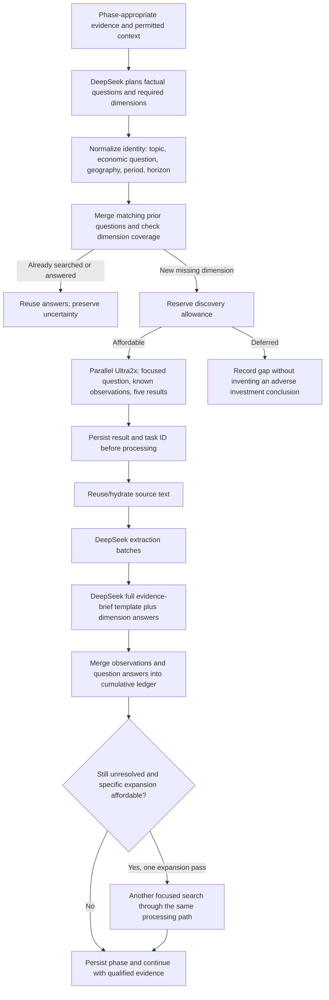
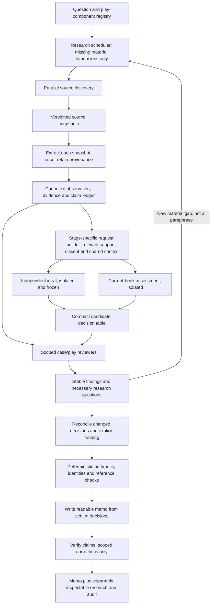

# Portfolio Search And Analysis: Payload Architecture Audit

## Scope And Verdict

Audited the actual saved requests from production run
`portfolio_positioning_job_portfolio_full_rerun_20260920_20260920_033409.json`,
workflow v4, release 355. The run started at 03:34:09 UTC and stopped awaiting
credit at 08:30:30 UTC on 20 September: 4h56m21s. The final consistency review
had not been submitted. This is the fresh rerun, not the older September 19
recovery still selected in the browser.

Read-only profiling resolved the production receipt references and measured
all 112 saved OpenRouter attempts. No paid analysis or search was started.
Source inspection refers to the current workspace; its output-cap removal is
local and not deployed. The findings below concern the deployed run's request
construction, not an assumed result from those local changes.

**The main failure is over-broad context propagation through a finite pipeline,
plus duplicated business objects and over-complete response contracts. It is
not an infinite recursive call loop.** Removing the 32k output cap fixes one
cause of truncation but does not fix this architecture.

The system currently conflates three distinct requirements:

1. Preserve all evidence in the run archive.
2. Make all evidence discoverable by the analyst.
3. Put nearly all evidence into almost every analyst request.

The first two are necessary. The third is not.

## Measured Workload

| Work | Successful tasks | Attempts including failures | Input tokens |
| --- | ---: | ---: | ---: |
| Source-linked fact extraction | 37 | 39 | 119,020 |
| Lane/question evidence briefs | 15 | 16 | 207,863 |
| Initial evidence reconciliation | 1 | 1 | 55,656 |
| Research-question planning | 4 | 4 | 490,886 |
| Independent allocation | 1 | 1 | 98,217 |
| Current-portfolio allocation | 1 | 1 | 122,029 |
| Two financial reviewers, four sections each | 8 | 8 | 1,259,687 |
| Provisional allocation | 1 | 3 | 904,075 |
| Source-support checks | 28 | 28 | 222,576 |
| Provisional/final investment details | 8 | 8 | 1,376,601 |
| Final allocation | 1 | 2 | 879,315 |
| Memo commentary | 1 | 1 | 332,109 |
| **Total model work** | **106** | **112** | **6,068,034** |

Separate retrieval: **15 Parallel Ultra2x tasks and three Perplexity requests**.
There were no additional citation-extraction tasks in this execution; that path
exists for citations without text. Provider polling GETs are not additional paid
research submissions. We cannot infer Parallel's internal search/tool count from
our 15 task receipts.

25 requests exceeded 100,000 input tokens and accounted for 5,203,195 input
tokens: **85.7% of the total**. The eight detail calls alone used 1.38 million
input tokens. This is not primarily a large number of small searches.

Observed research holdings: 578 observation records, 100 source records across
84 distinct URL strings, and 75 question records. Different source snapshots
and observation periods can legitimately coexist. All 578 exact observation
tuples are distinct; it would be wrong to call them all duplicate facts or
delete records using a loose text-similarity rule.

## Actual Architecture

This is the portfolio memo workflow, not the separate Analyst Council's
Stage 1/2/3 pipeline. Saved company-council research is an optional input after
the independent portfolio is frozen; this run had no company research attached.

```mermaid
flowchart TD
    T[Trading Terminal: portfolio, mandate, two plays] --> J[Job API: identity, credit preflight, checkpoint]
    J --> N[Freeze research cutoff and neutral constraints]
    N --> O[Three initial perspectives: macro, sector leadership, structural disruptions]
    O --> PA[Parallel Ultra2x: three discovery tasks]
    O --> PX[Perplexity GPT-5.6-sol: three cross-check requests]
    PA --> S[Source snapshots and citation excerpts]
    PX --> S
    S --> H{Citation text missing?}
    H -->|Yes| X[Reuse saved text; otherwise Parallel extraction in URL batches]
    X --> C[Chunk source text]
    H -->|No| C
    C --> F[DeepSeek: extract dated observation records]
    F --> B[DeepSeek: one analytical brief per initial lane]
    B --> E[Merge ledger; DeepSeek reconciles initial market context]
    E --> RI[Independent research phase: plan, retrieve, extract, brief, merge]
    RI --> I[DeepSeek: independent ideal; save before holdings or plays]
    I --> RC[Current-book research phase; reveal holdings and saved company evidence]
    RC --> A[DeepSeek: current-portfolio assessment; no ideal or plays in its prompt]
    A --> RP[Play research phase; reveal ideas and freeze seven component IDs]
    RP --> V1[DeepSeek exposure review: four sequential sections]
    RP --> V2[Opus defensive review: four sequential sections]
    V1 --> P[DeepSeek: provisional reconciled portfolio]
    V2 --> P
    P --> RQ[Challenge research phase for unresolved material questions]
    RQ --> K[DeepSeek: source-check selected claims; 223 facts in 28 batches]
    K --> D[DeepSeek: provisional investment details; five batches]
    D --> Z[DeepSeek: regenerate final reconciled portfolio]
    Z --> K2[Check newly cited facts if needed; reuse valid prior checks]
    K2 --> D2[DeepSeek: refresh changed final cases; three batches here]
    D2 --> W[DeepSeek: memo commentary]
    W --> Q[Opus: final consistency review; NOT REACHED in this run]
    Q -->|Material decision correction| U[DeepSeek: scoped decision revision]
    Q -->|No decision correction| END[Render and save memo]
    U --> V[Refresh affected cases and prose; verify changed claims]
    V --> Q2[One final Opus verification; no recursive revision loop]
    Q2 --> END
```

### Inside Every Focused Research Phase

The expansion branch is a bounded additional pass, not a recursive call back
into the entire memo. The implementation also processes deferred first searches
before expansions when budget remains.

### Runtime And Provider Responsibilities

| Component | Actual responsibility |
| --- | --- |
| Trading Terminal / job API | Submit portfolio and plays; resolve routing; launch the durable job |
| Portfolio orchestrator | Sequence information release, research phases, proposals, reviews and revisions |
| Parallel Ultra2x | Current-source discovery, source-backed excerpts and factual answer dimensions; not portfolio allocation |
| Perplexity / `openai/gpt-5.6-sol` | Three initial research cross-checks |
| `~deepseek/deepseek-flash-latest` | Extraction, research planning, briefs, ideal/current allocations, exposure review, reconciliation, cases and prose |
| `anthropic/claude-opus-5` | Defensive review and final consistency checking |
| Deterministic Python functions | IDs, date/source checks, numeric comparisons, funding ledgers, transitions, validation, rendering |
| Portfolio runtime | Model semaphore of four; receipts; validation/recovery; checkpoint/cache lookup; credit checks |
| Parallel task wrapper | Save submission intent and returned task ID; poll that task; do not blindly repeat uncertain paid POSTs |
| Record store | Full requests, outputs, evidence and audit history, with content-addressed files |

Fresh v4 runs do not call the old Tavily/Grok research paths. Those names remain
for historical checkpoint compatibility. Legacy allocator ensembles also remain
in source, but the v4 branch did not execute them in this run.

## How The Largest Call Was Built

Final reconciliation received **439,687 input tokens** on its successful second
attempt. The underlying business prompt serialized to **1,515,539 UTF-8 bytes**.
The following are measured field sizes, not estimated token counts:

| Field | Bytes | Share of prompt |
| --- | ---: | ---: |
| Evidence packet | 633,935 | 41.8% |
| Both reviewers' full results | 248,336 | 16.4% |
| Investment details, including copied proposal | 207,425 | 13.7% |
| Provisional recommendation | 173,967 | 11.5% |
| Computed decision checks | 110,258 | 7.3% |
| Independent and current-aware proposals | 114,788 | 7.6% |
| Remaining instructions, schema and inputs | 26,830 | 1.8% |

The evidence packet itself contained 423,310 bytes of facts, 158,771 bytes of
research questions/answers, 29,341 bytes of original market context, and 22,080
bytes of source metadata. The actual holdings context was only 2,492 bytes.
Instructions and schema are not the primary cause of this input size.

Exact repeated strings longer than 120 bytes account for 139,359 redundant
bytes in this prompt, about 9.2%. That is a conservative diagnostic, not a
semantic duplicate detector. **It would be inaccurate to say that most of this
single prompt is literally duplicated text.** The larger problem is repeating
large, mostly unchanged context across dozens of requests.

## Findings And Remedies

### P1: Focused Evidence Selection Expands Back To Global Scope

[evidence_for_decisions](/Users/Toms_Macbook/Projects/llm-council/backend/portfolio_tasks.py:78) begins with the entire
analytical evidence packet. It takes the assigned decisions' linked facts, then
unions in facts linked anywhere in the rest of the packet, including all
research-question answers and the initial market narrative. It also includes
every `observed_macro` fact. Anything not selected is still included in an
`other_observations` catalogue.

This makes the focus largely ineffective. The three final-detail requests,
each assigned at most four exposures, included respectively **481, 479 and 478
detailed facts**, all **75 questions**, and the remaining **97, 99 and 100 facts**
as a catalogue. Their evidence fields alone were approximately 600 KB each,
94%-95% of the complete prompt. They consumed 194,811, 193,954 and 192,705 input
tokens.

**Remedy:** select from explicit exposure/question/claim relationships, not all
references recursively found in a global JSON object. Include the assigned
exposure's supporting and contrary observations, relevant cross-asset drivers,
and known gaps. Keep the complete ledger available through stable IDs and an
explicit evidence lookup, not serialized into every specialist request. Use a
compact shared market snapshot rather than treating every fact labelled
`observed_macro` as universally relevant. Do not filter only to the model's own
cited facts; that would create confirmation bias.

### P1: Evidence Projection Is Not Idempotent And Loses Provenance

The provisional-detail caller at
[the investment-case step](/Users/Toms_Macbook/Projects/llm-council/scripts/portfolio_positioning_memo.py:3190)
passes `evidence_for_analysis(evidence)` into `_enrich_allocation`.
[That function](/Users/Toms_Macbook/Projects/llm-council/scripts/portfolio_positioning_memo.py:171) then passes the
already projected packet into `evidence_for_decisions`, which projects it again.

`investment_evidence` expects a raw ledger: `source_packet`, `claim_review`,
question `id`, and original market-context fields. Its own output uses `sources`,
`source_review`, `question_id`, and `initial_market_context`. It does not recognize
that output as already projected.

Offline replay on this run's ledger:

| Property | First projection | Second projection |
| --- | ---: | ---: |
| Observations | 578 | 578 |
| Source entries | 100 | 0 |
| Research questions | 75 | 0 |
| Initial market-context sections | 4 | 0 |
| Supported source-review labels | 80 | 0 |

All five saved provisional-detail prompts have zero source entries; their
observation excerpts and source IDs survive, but their URL catalogue does not.
This is a real correctness defect, not beneficial compression.

**Remedy:** distinguish canonical ledger and request-view types and project
exactly once. Pass the raw ledger to a single stage-specific request builder.
Add an invariant that repeated projection cannot erase source references,
coverage or adverse/supported review states. Test that every fact reference in
a request resolves to supplied metadata or an explicit available lookup.

### P1: Investment Details Carry A Second Copy Of The Proposal

`_enrich_allocation` returns the input proposal with enriched rows; it does not
return only investment details. Final reconciliation then sends both
`provisional_recommendation` and that full result as `investment_details`.
[Construction](/Users/Toms_Macbook/Projects/llm-council/backend/portfolio_independent.py:325).

Identical subtrees include play assessments (30,828 bytes), reviewer dispositions
(22,074), reconciliation (11,830), research assessment (10,066), market questions
(10,345), and many other fields. The 207,425-byte details object can be represented
as a **37,673-byte delta against the already supplied provisional object**,
including changed fields and metadata. This is an 81.8% reduction in that field,
approximately 11.2% of the whole final prompt, without deleting the provisional
analysis. A production delta contract also needs explicit removals and version IDs.

All five provisional detail batches additionally sent the same 170,651-byte
`recorded_allocation`, although they were asked about only two to four rows.

**Remedy:** return detail records keyed by exposure ID and decision version.
Send a compact portfolio weights/constraints table for capital context, not the
entire provisional discussion. Persist the assembled full proposal once outside
the model prompt.

### P1: Semantic Research Identity Is Delegated To Free-Text Model Labels

[normalize_questions](/Users/Toms_Macbook/Projects/llm-council/backend/portfolio_research.py:197) hashes normalized
`topic`, `economic_question`, geography, period and horizon. Normalization only
standardizes punctuation/case. [matching_question](/Users/Toms_Macbook/Projects/llm-council/backend/portfolio_research.py:100)
reuses an explicit ID or exact compatible wording; it does not reliably recognize
paraphrases. The same problem affects the string-based `searched_dimensions` check.

Three separately purchased searches asked for essentially the same OECD
inventory level/days-of-cover reconciliation, under different keys:

- `oil_commercial_inventories_days_cover` in current-book research;
- `oil-commercial-inventory-level-and-days-of-cover` in play research;
- `oecd-commercial-oil-inventories-and-days-of-cover` in challenge research.

Two earlier searches also covered overlapping oil inventory/tightness questions.
Thus **five of 12 focused searches overlapped on oil physical conditions**, while
uranium, oil-producer economics and the sovereign-debt/gold-versus-bonds mechanism
were deferred. Related questions are not always identical, but these overlapping
measurements should have shared a research case and source strategy.

The phase allowances were $2.52/$1.20/$3.00/$0.60, purchasing 4/2/5/1 searches.
Question counts grew by 20/17/15/23 records. Topic diversity is computed using
these model-generated topic strings, so renaming oil topics also defeats that
tie-breaker. A recorded `critical_premise` does not receive an explicit priority
in the current ranking key; ranking uses impact and position within topic.

**Remedy:** persist a research-case identity with a structured economic scope,
not the question's prose. Canonical dimensions should identify the measurement,
instrument/commodity, geography, observed period, forecast horizon and source
strategy. Resolve paraphrases against existing cases before reserving a paid
task. An LLM can propose an equivalence, but incompatible units/periods/regions
must remain distinct. Record unavailable/pending-publication measurements so a
new wording cannot buy the same failed investigation again. Prioritize distinct
material decisions and uncovered play components before reopening a case.

### P2: Every Focused Search Re-enters A General Macro-Brief Factory

[The common evidence builder](/Users/Toms_Macbook/Projects/llm-council/scripts/portfolio_positioning_memo.py:1480)
does extraction, then asks for executive summary, macro scorecard, market view,
quadrants, commodity prices, broker themes, asset implications, coverage,
watchpoints and source shortlist. A focused question adds `question_answers`
but retains that entire general schema.

There are 15 such successful briefs: three initial perspectives and 12 focused
searches. A small inventory or producer-cost inquiry should not require another
macro-allocation overview. The same citation snapshot can also be re-extracted
in a different lane because model-request identity includes the lane, query and
chunk grouping; source-text reuse is not the same as extraction-result reuse.

**Remedy:** separate ingestion from synthesis. Extract a source snapshot once
into a versioned observation store. A focused search should return the answer
dimensions, new/changed observations, contrary findings and remaining gaps.
Update the shared market brief only when those findings change the regime or a
cross-asset conclusion. Preserve different source versions and genuine revisions.

### P2: Reviewer Shards Re-accumulate Earlier Shards

[review_prompt_batches](/Users/Toms_Macbook/Projects/llm-council/backend/portfolio_independent.py:252) divides reviews
by question/play scope using a 400,000-character planning threshold. It repeats
both proposal summaries and a full observation catalogue in each part.
[run_financial_review](/Users/Toms_Macbook/Projects/llm-council/backend/portfolio_independent.py:296) then adds prior
sections' findings and expands their linked evidence after that grouping step.

Both roles executed four sequential sections. Opus part three reached 489,046
bytes / 210,972 input tokens; part four carried 53,796 bytes of previous review
sections. A single large play can also exceed the planning threshold because
that code does not split within a play. This threshold groups work; it does not
truncate content or enforce a provider output limit.

The combined eight calls used 1.26 million input tokens. Their merged findings
then entered provisional reconciliation, final reconciliation, derived checks
and final-review construction again.

**Remedy:** independent review tasks per research case or play component, each
with a compact common allocation table. Save findings under stable issue IDs;
join findings in code. Only cross-cutting contradictions require a separate
integration pass. Pass prior conclusions or changed issues by ID, not all prior
review narratives. Re-measure the actual dispatch payload after all additions.

### P2: Final Reconciliation Is A Full Regeneration Contract

The successful final response returned 47,486 completion tokens, including only
2,350 reported reasoning tokens. Roughly 95% was therefore non-reasoning output,
not an excessively long hidden chain of thought.

The requested schema produced 20 targets, 28 reconciliation entries, 77 reviewer
dispositions, 20 research dispositions, 18 current-sleeve actions, 19 research
assessments, play assessments, monitoring rules, forecasts and a second funded
alternative. Much of the same content already existed in the provisional result.

The system asks the model to reproduce unchanged reasoning and accounting views
in several representations, then checks whether those representations agree.
This creates both larger output and new opportunities for contradictions.

**Remedy:** settle a canonical decision table once. Final reconciliation should
return changed decisions, funding counterparts, changed play verdicts and
new/resolved finding IDs. Merge the delta deterministically. Derive repeated
weights, current-versus-final rows, counts and arithmetic from that table. Give
the memo writer the settled decision and relevant evidence, not a requirement to
rewrite the entire audit trail. Keep the full audit available separately.

### P2: Whole-document Repairs Add Another Large Answer To The Prompt

The failed second provisional attempt generated 47,825 output tokens but was not
parseable as an object. The generic repair path sent the original request plus
that complete previous answer back to the model. Input grew from 286,940 to
330,255 tokens: **43,315 additional input tokens**.

[Runtime retry construction](/Users/Toms_Macbook/Projects/llm-council/backend/portfolio_runtime.py:593) has at most
three attempts. It does not recursively append every historical attempt forever,
but a full repair still repeats the original evidence and previous output.

**Remedy:** use structured outputs where supported, deterministic repairs only
for unambiguous serialization defects, and scoped field/row patches when parsed
content is otherwise usable. Separate syntax repair from financial regeneration;
never ask a syntax repair to reconstruct facts or reconsider allocations.
Truncated content must remain visibly incomplete, with received work preserved.

### P2: Long-running Requests Have Weak Internal Visibility

The OpenRouter adapter awaits a non-streaming completed response. Its HTTPX
`timeout` is not a total job-duration deadline: read timeout measures the wait for
the next network chunk. A connection that continues receiving chunks can run far
longer. [HTTPX timeout semantics](https://www.python-httpx.org/advanced/timeouts/).

The successful final-allocation attempt took 34.1 minutes; the independent
allocation 26.1 minutes; initial reconciliation 17.2 minutes. Parallel tasks in
this run took about 2.6-10.8 minutes apiece. Serial phase barriers and waiting for
the slowest task compound these delays. Six retry requests are not the main
explanation for nearly five hours.

**Remedy:** stream and persist received output/progress, distinguish queue time,
first response, generation and local validation, and alert on abnormal elapsed
time without discarding output. Where the provider supports durable background
tasks, persist the task handle and poll it. Do not implement another arbitrary
timeout that kills useful analysis merely because it is slow. Provider-side
generation rate and internal work cannot be reconstructed from these receipts.

## What Is Working And Must Be Preserved

- Independent ideal is saved before holdings; current assessment does not receive
  the ideal or plays. User plays are introduced afterwards for explicit critique.
- Source excerpts remain separate from provider-generated research summaries.
- Sources, observations, requests and results are preserved in checkpoints.
- Only selected cited claims receive expensive source-support review; this run
  checked 223 facts in 28 batches, not all 578 observations indiscriminately.
- Valid source checks and identical completed model requests can be reused.
- Parallel submissions retain task IDs and do not blindly resubmit ambiguous POSTs.
- Supplementary research gaps can qualify/defer recommendations without deleting
  the memo. Source verification is not interchangeable with financial conviction.
- The final decision-revision pass is bounded; no whole-pipeline recursive loop
  was found in this v4 execution.

## Proposed Target Architecture

The gap loop is governed by case state, source strategy and research allowance;
it is not an invitation to repeat a search until the model likes the answer.
The initial independent/current/plays information boundaries still apply.

The request builder is the important change. Its purpose is **relevance and
provenance**, not a token ceiling or evidence allowlist. Every observation stays
in the canonical store and can be fetched when relevant. A large genuinely
cross-asset question can still receive a large packet.

## Implementation Order And Release Evidence

1. Introduce explicit ledger/request-view types; fix double projection and its
   provenance loss. Test the actual 578-observation artifact offline.
2. Return detail deltas, remove duplicated proposal metadata, and replace repeated
   full allocations in detail calls with compact stable-ID tables.
3. Replace global-reference union with case/exposure-scoped evidence selection,
   including contrary evidence and a permitted full-ledger lookup.
4. Establish persistent research cases/dimensions and source-snapshot extraction
   caching. Test the three inventory paraphrases collapse to one economic case,
   while different periods, commodities and forecast/observed values stay distinct.
5. Separate focused question-answering from initial macro synthesis; replace
   reviewer-history accumulation with issue-ID-based integration.
6. Make final settlement a delta contract and give editorial writing a separate
   input model. Use deterministic code for numbers repeated across UI sections.
7. Add per-dispatch payload accounting, streaming progress and cost estimates
   based on the actual phased plan rather than the obsolete historical workload.

Before another paid benchmark, replay request construction from the saved run
and publish, for every stage: bytes by field, facts/sources/questions included,
why each item is relevant, repeated object IDs, model usage, and scope expansion
since the previous pass. Verify no critical contrary evidence or play component
disappears and that every cited ID resolves. Do not turn byte-size observations
into another automatic output cutoff.

The measured detail-delta reduction is reproducible. Broader token, time and
quality savings remain hypotheses until those changes are implemented and
compared using the same frozen evidence and portfolio. No speedup or investment
quality improvement is claimed from this audit alone.

## Reproducible Evidence

- [Payload profiler](/Users/Toms_Macbook/Projects/llm-council/outputs/audits/portfolio-full-rerun-20260920/payload_audit.py)
- [All 112 profiled requests](/Users/Toms_Macbook/Projects/llm-council/outputs/audits/portfolio-full-rerun-20260920/payload-profile.json)
- [Aggregated counts and usage](/Users/Toms_Macbook/Projects/llm-council/outputs/audits/portfolio-full-rerun-20260920/payload-summary.json)
- [Summary calculation](/Users/Toms_Macbook/Projects/llm-council/outputs/audits/portfolio-full-rerun-20260920/summarize_payloads.py)
- [Earlier interim financial audit](/Users/Toms_Macbook/Projects/llm-council/docs/portfolio-full-rerun-audit-20260920.md)

Byte measurements use UTF-8 JSON with the same ordinary separators as the
runtime's business prompt. Reported provider token counts are taken from receipts,
not inferred from bytes. Retry messages can be larger than the original prompt.
Request-duration sums overlap for concurrent calls and must not be presented as
wall-clock runtime. Historical receipt limits remain historical evidence.
