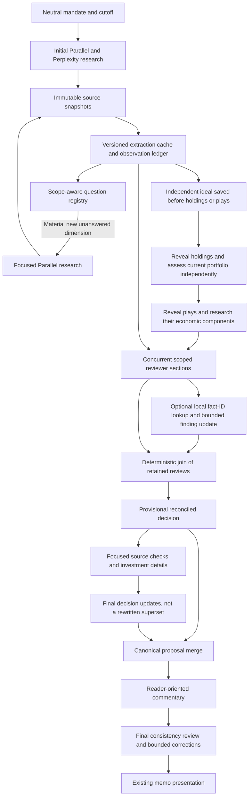

# Portfolio Payload Redesign

Status: implemented locally, not deployed. The ordered work and verification
status are in [the remediation ledger](portfolio-architecture-remediation-ledger-20260920.md).
The production baseline is documented in [the payload audit](portfolio-payload-architecture-audit-20260920.md).

**September 21 review:** several implementation claims below are incomplete.
The [second-pass review](portfolio-redesign-review-20260921.md) documents stale
detail reuse, missing whole-book context, omitted review arguments, incorrect
credit-recovery state and other remaining large-call paths. Its findings and the
revised ledger supersede the completion assessment here. This document records
the September 20 implementation, not a release approval.

## What Changed

The redesign separates stored evidence, request-specific evidence, investment
decisions and their audit history. It does not remove research from the archive,
change model assignments, introduce another output-token ceiling, or change the
memo layout.

### Evidence And Specialist Requests

`backend/portfolio_tasks.py` identifies its investment request view explicitly.
Reprojection returns an independent copy of that view instead of treating it as
a raw ledger. Older views containing `sources` and `initial_market_context` are
also recognised. Source catalogues, question identities and source-review
verdicts therefore survive the provisional detail path.

Specialist scoping now uses declared exposure identifiers, display aliases,
baseline references, research-question IDs, play IDs and component IDs. A
question contributes all its answers, contrary evidence and unresolved
dimensions, not only the allocator's chosen citations. Other observations of
the same benchmark/metric/unit series remain visible. Arbitrary references in
the global narrative no longer pull the entire ledger into a small case.

An unknown or unlinked exposure is explicitly under-researched; it does not
silently receive every unrelated observation. Research-question IDs allow new
exposures to use evidence without needing an exact display-name match.

Reviews retain a compact discovery catalogue. A reviewer can request full
excerpts for specific uncited fact IDs. This is a local archive lookup, followed
by one bounded amendment of the affected findings or play judgments, not another
web search. The original completed review is saved before this optional lookup.

### Research Reuse

`backend/portfolio_research.py` supplies the planner with a persistent registry
of question identities, observation scopes, required dimensions and previously
searched dimensions. Identity excludes cosmetic topic headings. Structured
scope distinguishes subject, measure, region, period, horizon and observation
basis. Explicit aliases map paraphrased dimensions to prior searches.

The original canonical identity survives later phases. A changed period cannot
reuse an old question merely by naming its ID. Previously searched but unavailable
dimensions remain gaps, rather than becoming new searches under another heading.
Critical premises rank first; prior subject coverage is considered when ordering
otherwise equally material searches. Supplied component IDs are retained when
valid, rather than discarded when the planner omits redundant component names.

This is not a claim of perfect semantic deduplication. Models must still propose
correct canonical identities or explicit reuse. The application deliberately
does not guess that superficially similar financial measures are equivalent.
Distinct observations, revisions and source snapshots remain separate.

### Source Processing

Focused searches now produce dimension answers and specific limitations. They
do not regenerate macro scorecards, regime probabilities, broker themes and
whole-portfolio implications.

Source extraction uses a neutral, versioned observation contract. Cache identity
includes model, extraction contract, research cutoff, source identity, publication
date and exact text chunk. Completed chunks can be reused across different lane
groupings. Sorted per-chunk locks prevent concurrent extraction of the same
snapshot. Changed text, dates, contracts or models do not hit that cache.

Each cached fact must cite that source and an excerpt actually in the chunk.
Ambiguous multi-source or mismatched extraction is retained in the response but
not promoted into a reusable snapshot entry. Cache entries survive checkpoints;
information boundaries still determine which source snapshots may be requested.

### Reviews And Reconciliation

Reviewer sections now execute independently under the existing four-request
runtime semaphore. They receive scoped baseline arguments and a compact
whole-portfolio weight table. Completed sections are saved independently and
joined in original order. Previous section narratives are not appended to later
requests. A funding interruption still leaves successful sections available.

Investment-detail requests carry a compact whole-book allocation table instead
of another complete proposal. Stored detail records contain the four detail
fields, status and decision/evidence hashes. Those hashes preserve reuse for
unchanged cases without copying the original essays into the detail object.

Final reconciliation uses `portfolio-final-delta-v1`: changed target rows,
explicit removals and changed judgments. The application merges identifiers and
preserves omitted fields. It does not fill an omitted delta field with a null
that erases existing analysis. Invalid or unfunded updates remain archived as an
unapplied candidate; the provisional proposal remains available and is clearly
qualified. The final consistency reviewer receives those pending issues.

Funding-check payloads retain totals, transitions and issues, not repeated
investment essays in each calculated row. Commentary receives the decision
document and both baseline arguments without old drafts or derived audit copies.
The same distinction applies to targeted reconsideration and post-review prose.

### Financial Integrity

- A valid play-component ID survives a display-name variation. A name matching
  another registered component is still flagged. The reported name is retained.
- Rejected capital mappings do not append the same action weight as additional
  capital. Their unresolved current-position mapping is recorded separately.
  Uncertainty does not become a fabricated equivalence or a zero current weight.
- Explicit exits still count as exits; a miner-to-bullion switch cannot disappear
  through a model's unsupported equivalence claim.
- Repeated identical relationship declarations count once.
- Time changes calculate later minus earlier regardless of input ordering.
  Revision changes use publication chronology. Different instruments or missing
  chronology remain unresolved, not guessed.
- No cash balancing plug or automatic rescaling conceals an invalid total.

### Recovery And Long Calls

JSON presentation repair is local and narrowly defined: fences, literal control
characters and trailing commas outside strings. Duplicate keys are rejected
rather than silently selecting a financial value. Missing numeric values and
partial strings are never invented.

For usable JSON with an invalid field, only the faulty top-level fields are
requested again; valid large fields remain saved. A non-parseable answer is not
appended wholesale to the next prompt. If a provider's native limit is reached,
fully received top-level portfolio values can be retained with explicit
limitations when the resulting contract validates. A partially received
allocation array is not completed synthetically. Delta contracts must arrive
in full because an omitted change has a different meaning from no change.

Portfolio OpenRouter calls stream. Progress distinguishes provider connection,
received text and validation, with first/last-content timestamps, received
character count and provider request ID. Chunks are journalled beneath
`.portfolio-streams/`; this retains output during a long call. The five-second
flush cadence controls disk I/O, not generation length. Full artifact checkpoints
are not rewritten for every chunk.

Submission intent is checkpointed before a streamed paid request. An interrupted
request with an uncertain outcome is not automatically resubmitted on resume.
Its provider ID and journal are retained for reconciliation. Connection failures
before dispatch can retry; read/write/protocol failures with uncertain outcomes
do not automatically spend again. This avoids duplicate billing but does not
make OpenRouter streams provider-resumable: a lost connection may still require
operator review of the retained output and provider record.

The non-streaming OpenRouter interface remains the default for other callers.
OpenRouter documents streamed content deltas and usage in its
[chat API](https://openrouter.ai/docs/client-sdks/python/api-reference/chat).

## Updated Flow



The research edge is controlled by the registry, phase allowance and existing
bounded expansion policy. It is not a recursive whole-memo restart. Every model
request sits inside the receipt/checkpoint/stream-journal runtime.

## Offline Measurements

Using the saved September 20 run and the production request profile:

| Comparable object | Before | After |
| --- | ---: | ---: |
| Evidence plus repeated allocation context across five provisional detail batches | 2,529,062 bytes | 507,622 bytes |
| Stored investment-detail request object | 207,425 bytes | 39,329 bytes |
| Final reconciliation request | 1,515,539 bytes | 1,265,092 bytes |
| Defensive review sections | 4 | 3 |

The first reduction is **79.9%**, the second **81.0%**, and the final request
reduction **16.5%**. Source counts in the five provisional detail requests are
now 26, 37, 19, 12 and 8, rather than zero. The archive still has all 578 facts,
100 source records and 75 questions. Reprojection is idempotent.

These are offline serialized-byte comparisons, not measured token bills,
completion times or improved investment returns. Provisional reconstruction uses
the final saved evidence ledger as a conservative retrospective test. The final
reconciler intentionally still receives broad strategic evidence and arguments;
it remains the largest request. Its output is now a delta, but a paid evaluation
is needed to measure whether the model follows that contract reliably and whether
financial judgments improve.

Reproduce without paid calls:

```sh
.venv/bin/python -m scripts.audit_portfolio_payloads \
  outputs/audits/portfolio-full-rerun-20260920/latest.json \
  --profile outputs/audits/portfolio-full-rerun-20260920/payload-profile.json \
  --output outputs/audits/portfolio-full-rerun-20260920/redesign-benchmark.json
```

## Release Boundaries

Changed prompts must not be labelled cache hits for old decisions. Exact request
validation and the existing explicit resume rules remain in force. Research
receipts and source-snapshot extraction can be reused at their proper information
boundaries. No old memo or production checkpoint was rewritten by this work.

Local tests cannot establish provider-native output defaults, live search quality,
or the financial quality of a fresh memo. Deployment and a paid comparison remain
separate actions. The current production run has not been restarted.
