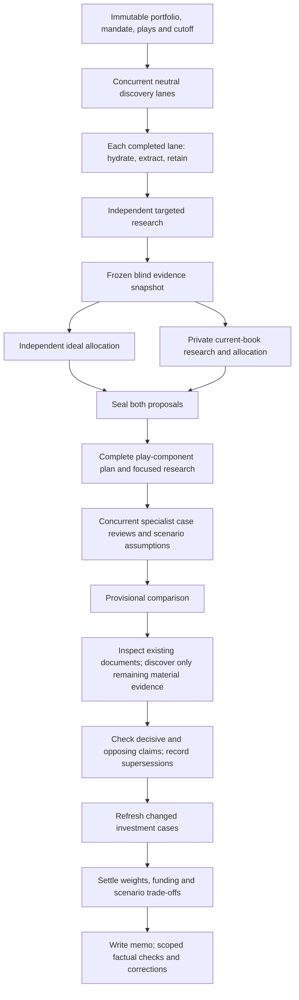

# Portfolio Uplift Implementation

**September 22 acceptance update:** the controlled R360 run failed after 5h34;
its release-361 recovery was stopped by the user after another 8h30m20s without
a final memo. The [full stopped-run audit](./portfolio-r360-run-audit-20260922.md#september-22-stop-decision-and-full-reassessment)
reassesses every U01-U17 item and defines the current A00-A14 priorities. The
historical local tests and deployment below are real, but are not evidence of
acceptable live workload or completed financial improvement. Current work is
offline assessment/remediation; the recovery follow-up is deleted. No fresh run
or subsequent deployment is implied.

This ledger tracks the 17 items in `portfolio-evidence-decision-uplift-draft-20260921.md`.
The implementation pass was local-only. The user subsequently authorised deployment: the tested workspace, including R01-R09, is deployed to `llm-council-analysis` as Fly release **360** on 21 September 2026. No paid analysis was started.

## Deployment Record

- Production machine: `683d6eeb612638`, Sydney; release **360**, replacing **359**.
- Image: `registry.fly.io/llm-council-analysis:deployment-01M320FDB02NN13MY51VY3GNJG`.
- Digest: `sha256:f048e8130a73e44bd40482b01c8e109205f92a2f7020758cba86932cb045e58b`.
- No queued/running analysis jobs before rollout. Persistent volume and saved outputs retained; terminal applications were not redeployed.
- Remote frontend build passed. Fly smoke/readiness checks passed; public `/readyz` reports ready, and the portfolio page, JavaScript and CSS assets return HTTP 200.
- SHA-256 hashes of the nine repaired backend/orchestrator files match the tested local sources.
- All **9/9** offline audit probes also pass inside the deployed production image, using mocked providers and in-memory runtimes. This is not a paid financial-quality comparison.

**Second-pass remediation:** the nine defects R01-R09 in [the follow-up review](./portfolio-uplift-second-pass-review-20260921.md) are fixed locally, with all nine original probes passing and 30 new regression cases. This does not complete the entire uplift: broader source inspection, scenario-comparison scope, stress coverage and controlled financial-quality validation remain outstanding. The table distinguishes those limits from the verified fixes.

| Items | Historical implementation status before live acceptance | Narrow verification |
| --- | --- | --- |
| U01 Source context | R04 fixed; source-format scope still partial | Inspected evidence survives supplementary discovery/extraction failures and resume. General HTML expansion and PDF content-type endpoint detection remain open. |
| U02 Typed observations | R01 fixed and regression-tested | Present periods, measurement basis, applicability and locators share a validation/recovery/support contract. Explicitly contradicted fields cannot be called supported; optional metadata does not discard output. |
| U03 Correction propagation | R02 fixed and regression-tested | Review fingerprints and canonical supersession edges survive merge/recovery, including reversed merge order and correction chains. Changed source content cannot inherit an old supported verdict. |
| U04 Opposing evidence | Selection and retention verified locally | Question/comparison relationships and both frozen copper surplus forecasts survive selection. R02/R04 retention defects are repaired; live analytical use still needs comparison. |
| U05 Case refresh | Connected and tested; financial acceptance pending | Changed case dependencies trigger review before settlement. Typed review and evidence retention defects are repaired; generated investment-case quality remains unproven. |
| U06 Scoped corrections | R06 fixed and regression-tested | The checker and applicator share current-document prose paths, including sleeve rationales and scenario assumptions. Exact/hash guards protect allocations, identities and archived cases. |
| U07 Funding | Arithmetic and explanation routing verified locally | R05 separates balanced arithmetic from unresolved funding explanations and sends declared-source issues through existing reviewer context. |
| U08 Play coverage | R03 fixed; semantic quality needs live evaluation | Freezing requires an explicit original-input completeness assessment. Partial decomposition receives bounded repair; late omissions invalidate the receipt. Known components and provisional assessments survive repair failure. |
| U09 Scope and horizon | Implemented locally | Mandate reaches initial Parallel retrieval and later planners. Removed fixed 12-24 month framing. Unknown geography, currency and portfolio scope stay explicit. |
| U10 Investment mechanics | Contracts implemented; financial acceptance pending | Existing case review owns the causal chain and sizing trade-off. Prompt/schema presence is not proof of a correct generated investment case. |
| U11 Scenarios | R07 fixed; comparison scope still partial | Incomplete numerical scenarios retain qualitative analysis and valid computed values. Independent ideal still lacks its own dedicated scenario comparison view. |
| U12 Ready-task scheduling | Overlap and R04 failure retention verified | First searches and completed lanes overlap. Successful inspections now remain active after supplementary failures; live critical-path improvement is unmeasured. |
| U13 Private baselines | Isolation/overlap verified; stress acceptance pending | Blind/current branches and mocked resume pass. Memory-aware admission and full crash/dependency tracing remain unestablished. |
| U14 Provider performance | R09 fixed; live policy comparison pending | Attempt-local timing resets correctly and separates provider completion from local work. Optional routing policy remains unchanged; no latency improvement claimed without measurement. |
| U15 Monitoring | R08 fixed and regression-tested | Canonical timestamp/period identity prevents duplicate persistence. Conflicts at earlier required points and unknown offsets stay explicit; distinct observations can satisfy conditions. |
| U16 Editorial contracts | Reader preserved; generated quality pending | Theme rationale and established light/dark reader are unchanged in this repair. R06 extends factual correction coverage; new-run writing still needs comparison. |
| U17 Regression evaluation | R01-R09 covered; broader acceptance pending | All nine original probes now pass, with 30 new regular regression cases. Real source fixtures still skip in a clean checkout; controlled comparison and wider crash stress remain pending. |

Code tests can establish data preservation and financial arithmetic. They cannot establish that a future model will produce a better investment judgment. That requires the separately authorised controlled comparison.

## Actual Execution Flow

Play research still starts after both baseline proposals. The overlap intentionally removes the demonstrated idle time without introducing a third private research branch or increasing the model concurrency limit.

## Verification

- Baseline before edits: 517 portfolio tests passed.
- Original uplift unit suite: 625 passed, 5 warnings, 132.58 seconds (`pytest tests/unit`).
- Follow-up audit before repair: 625 passed, 5 warnings, 143.35 seconds; the independent counterexample script nevertheless reproduced all nine defects. This is why the additional failure-boundary cases were added.
- R01-R09 repair: all nine original probes pass. The new `test_portfolio_uplift_second_pass.py` contains 30 passing cases; the adjacent redesign, research and handoff modules also pass (65 tests).
- Full unit suite after R01-R09 repair: **655 passed, 5 warnings, 129.23 seconds**. Focused Python correctness lint and `git diff --check` pass. No new browser/build check was needed or performed for this backend-only repair; the frontend verification below belongs to the original uplift.
- Focused Python correctness lint (`ruff --select F,E9`), frontend component ESLint and `git diff --check` passed.
- Production frontend build passed. The existing large-chunk warning remains; no bundling redesign was included in this pass.
- Frozen World Bank PDF retains the annual/quarterly/monthly header hierarchy and the actual 82.6/90.9 Brent and 77.7/82.7 WTI columns.
- Frozen final-run replay retains both named copper surplus observations alongside the deficit evidence, without including the entire archive.
- Mocked complete pipeline forces the current-aware branch to dispatch before the blind branch finishes, checks information separation, and replays its checkpoint without repeating completed model work.
- All six browser cases passed at 1440/768/390 widths in light/dark mode. The fixture blocks every non-GET API request and checks collapsed supporting research, compact theme headings with expandable rationale, no reader errors and no unsolicited supporting-data fetches.

## Remaining Scope and Validation

1. Run the controlled paid comparison after approval. In particular, verify that generated cases actually reconcile late evidence, interpret refinery versus upstream economics, and explain retained weights. Tests do not prove better financial judgment.
2. Measure serving-provider latency/cost on comparable workloads before changing the default preference. The optional API policy is supported by [OpenRouter's provider-routing documentation](https://openrouter.ai/docs/guides/routing/provider-selection); no fixed run-time improvement is promised.
3. Source inspection is selective, not exhaustive. PDF coordinate extraction retains ambiguity rather than claiming a full document has been read. Non-PDF excerpts retain explicit excerpt-only coverage; unanswered source questions can still require discovery.
4. Existing terminal currency/scope data was not invented or expanded into a compulsory questionnaire. Where absent, the memo remains allocation-level with implementation uncertainty.
5. Existing completed memos and original baseline proposals are not rewritten by this pass. Correction propagation applies to a new/recovered workflow; the frozen replay does not retroactively certify an old memo.
6. Add a dedicated independent-ideal scenario comparison; the current operational comparison covers destination and smaller-change proposals against the current portfolio.
7. Full memory-aware admission, dependency/wait tracing and simultaneous-completion crash stress are not established by the current overlap/resume tests.
8. The two real-world audit source fixtures remain local/untracked. Supply redistributable fixtures or a documented acquisition mechanism before treating those checks as clean-checkout CI coverage.

The implementation pass did not deploy. The later authorised deployment is recorded above; it did not change model-routing settings, buy credits, start a paid analysis or delete checkpoints.
